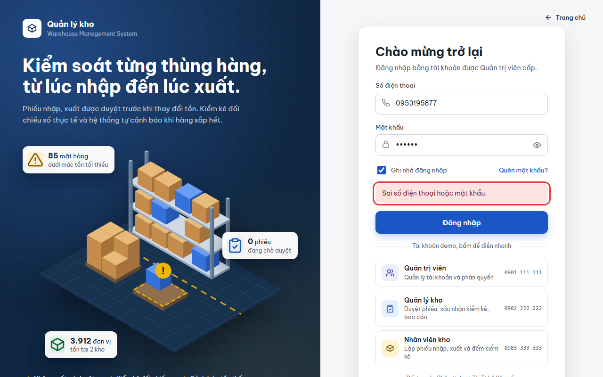
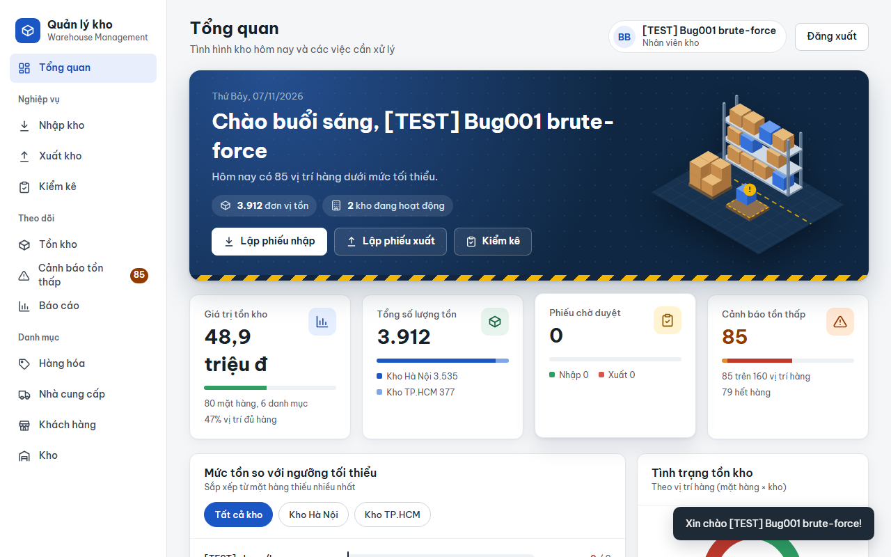
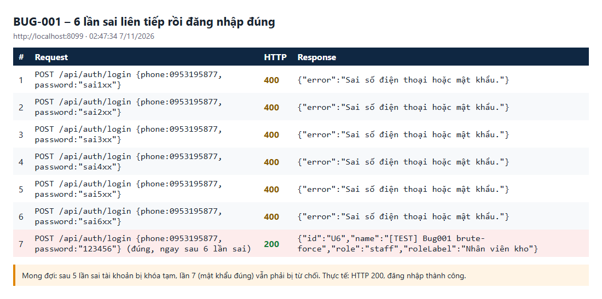

# BUG-001: Không khóa tạm tài khoản khi đăng nhập sai nhiều lần liên tiếp

| | |
| --- | --- |
| **Mức độ** | Major |
| **Trạng thái** | Closed |
| **Liên quan** | RISK-07 · TC-SEC-03-01 (QLKho_Test_Tracker) · UC01 Đăng nhập |
| **Môi trường** | local-H2, http://localhost:8099, Chromium headless, 07/11/2026 02:47 |
| **Phiên bản** | commit `aaaf02b` |
| **Vai trò** | mọi vai trò (tái hiện bằng tài khoản Nhân viên kho tạo riêng cho test) |
| **Người ghi** | QA_QC (tự động: playwright-bdd) |
| **Ngày** | 2026-11-07 |

## Tóm tắt

Máy chủ không đếm số lần đăng nhập sai. Sau 6 lần sai liên tiếp, lần đăng nhập đúng ngay sau đó vẫn thành công. Đặc tả kiểm thử (RISK-07) yêu cầu khóa tạm sau 5 lần sai. Hiện không có gì cản việc dò mật khẩu: không khóa tạm, không giới hạn tần suất, không captcha.

## Bước tái hiện

1. Admin tạo tài khoản `[TEST] Bug001 brute-force`, vai trò Nhân viên kho, trạng thái **Hoạt động**, mật khẩu `123456`.
2. Mở trang chủ, bấm **Đăng nhập**.
3. Nhập SĐT của tài khoản trên với mật khẩu sai (`sai1xx` … `sai6xx`), bấm **Đăng nhập**. Làm 6 lần liên tiếp.
4. Lần thứ 7 nhập đúng mật khẩu `123456`, bấm **Đăng nhập**.

## Kết quả thực tế

- Cả 6 lần sai đều chỉ báo `Sai số điện thoại hoặc mật khẩu.` (HTTP 400). Không có cảnh báo số lần còn lại, không có thông báo khóa tạm.
- Lần thứ 7 (mật khẩu đúng) trả **HTTP 200**, vào thẳng màn **Tổng quan**.

```
POST /api/auth/login {phone, password:"sai1xx"} → 400 {"error":"Sai số điện thoại hoặc mật khẩu."}
… (lần 2 – 5 giống hệt)
POST /api/auth/login {phone, password:"sai6xx"} → 400 {"error":"Sai số điện thoại hoặc mật khẩu."}
POST /api/auth/login {phone, password:"123456"} → 200 {"id":"U6","name":"[TEST] Bug001 brute-force","role":"staff",…}
```

**Ảnh chụp**

| | |
| --- | --- |
| Lần sai thứ 6: chỉ báo sai, không khóa |  |
| Lần 7 (mật khẩu đúng): đăng nhập thành công |  |
| Nhật ký 7 request API |  |

## Kết quả mong đợi

- Sau **5 lần sai liên tiếp**, tài khoản bị khóa tạm (ví dụ 15 phút) hoặc request bị giới hạn tần suất.
- Trong thời gian khóa, kể cả mật khẩu đúng cũng bị từ chối (HTTP 400 hoặc 429) với thông báo kiểu `Đăng nhập sai quá nhiều lần. Vui lòng thử lại sau 15 phút.`
- Đăng nhập thành công thì bộ đếm về 0.

## Chi tiết kỹ thuật

- Mật khẩu tối thiểu chỉ 6 ký tự (`UserService.checkPassword`) và tài khoản demo dùng `123456`. Không có khóa tạm thì có thể dò mật khẩu không giới hạn.
- Ứng dụng đang chạy công khai trên Render (https://qlkho-web.onrender.com), nên ai cũng gọi được `/api/auth/login`.

## Test phát hiện

`e2e/features/02-bao-mat.feature` :: **SEC-03 › Đăng nhập sai liên tiếp 6 lần** (`@TC-SEC-03-01 @risk`)

- Step kiểm tra: `e2e/steps/auth.steps.ts:239`, lỗi `expected 400, received 200`.
- Trace và video: `e2e/output/test-results/features-02-bao-mat.featur-8245d-ng-nhập-sai-liên-tiếp-6-lần-bdd/` (xem bằng `npx playwright show-trace …/trace.zip`).
- Chạy lại: `cd e2e && BASE_URL=http://localhost:8099 npx bddgen && npx playwright test --project=bdd -g "TC-SEC-03-01"`

## Phân tích nguyên nhân

File / hàm: `src/main/java/com/qlkho/service/AuthService.java`, hàm `login()` (dòng 28–45).

Hàm chỉ so khớp mật khẩu bằng `encoder.matches(...)` rồi trả lỗi chung. Không lưu số lần sai, thời điểm sai, hay thời hạn khóa. Bảng `UserAccount` cũng không có trường nào cho việc này.

Hướng sửa gợi ý: thêm `failedCount` và `lockedUntil` vào `UserAccount` (hoặc giữ một map trong bộ nhớ theo SĐT/IP). Trong `login()`:

1. Từ chối ngay nếu `lockedUntil > now`.
2. Khi sai thì tăng `failedCount`; đủ 5 lần thì đặt `lockedUntil = now + 15 phút`.
3. Khi đúng thì đặt lại về 0.

Vẫn giữ thông báo chung để không lộ SĐT có tồn tại hay không.

## Đóng

- Commit sửa: `00fdf23` Fix BUG-001..011 (nhánh main, github.com/khanhle1511/Quan_Li_Kho_Hang)
- Ngày đóng: 2026-11-07
- Kiểm tra lại bằng: `TC-SEC-03-01`
- Cách sửa: `AuthService.login()` giữ bộ đếm sai theo SĐT trong bộ nhớ (`ConcurrentHashMap`), sai 5 lần liên tiếp thì khóa 15 phút (`MAX_FAILED`, `LOCK_MINUTES`); trong thời gian khóa mật khẩu đúng cũng bị từ chối với thông báo "Đăng nhập sai quá nhiều lần. Vui lòng thử lại sau N phút."; đăng nhập đúng thì bộ đếm về 0. Đếm cả SĐT không tồn tại nên không lộ tài khoản có thật. Bộ đếm mất khi khởi động lại máy chủ (chấp nhận được với đặc tả hiện tại).
- Kết quả kiểm tra lại (07/11/2026, local-H2 cổng 8097): TC-SEC-03-01 đạt; curl: lần sai thứ 5 và 6 trả 400 kèm thông báo khóa, mật khẩu đúng sau đó trả 400, tài khoản khác sai 4 lần rồi đúng vẫn đăng nhập được (200). Feature 01-xac-thuc, 02-bao-mat không có test nào hỏng thêm.
