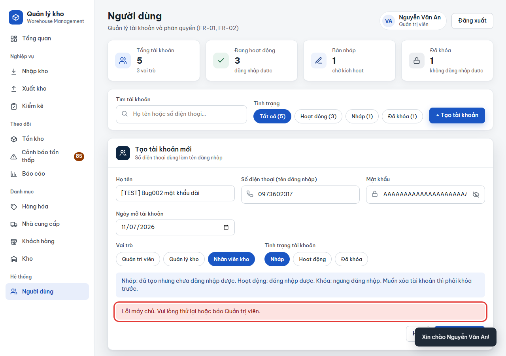
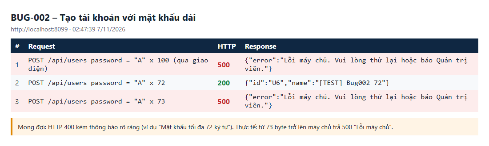

# BUG-002: Mật khẩu dài hơn 72 byte gây lỗi 500 khi tạo hoặc đổi mật khẩu tài khoản

| | |
| --- | --- |
| **Mức độ** | Minor (lỗi 500 với thông báo chung; dữ liệu không bị hỏng, đi vòng được bằng mật khẩu ngắn hơn) |
| **Trạng thái** | Closed |
| **Liên quan** | RISK-08 · TC-SEC-03-02 (QLKho_Test_Tracker) · Quản lý tài khoản (FR-01, FR-02) |
| **Môi trường** | local-H2, http://localhost:8099, Chromium headless, 07/11/2026 02:47 |
| **Phiên bản** | commit `aaaf02b` (Spring Boot 3.5.16, spring-security-crypto 6.5.11) |
| **Vai trò** | admin |
| **Người ghi** | QA_QC (tự động: playwright-bdd) |
| **Ngày** | 2026-11-07 |

## Tóm tắt

Khi Admin tạo tài khoản hoặc đặt lại mật khẩu bằng một mật khẩu dài hơn **72 byte**, máy chủ trả **HTTP 500** và giao diện hiện `Lỗi máy chủ. Vui lòng thử lại hoặc báo Quản trị viên.` Người dùng không biết mình sai ở đâu.

Giới hạn tính theo **byte UTF-8**, không theo ký tự. Vì vậy mật khẩu tiếng Việt có dấu chỉ khoảng **37 ký tự** đã dính lỗi; 40 chữ `đ` là 80 byte.

## Bước tái hiện

1. Đăng nhập Admin (`0901 111 111` / `123456`).
2. Vào **Người dùng**, bấm **+ Tạo tài khoản**.
3. Điền:
   - Họ tên: `[TEST] Bug002 mật khẩu dài`;
   - SĐT hợp lệ chưa dùng (ví dụ `0973602317`);
   - Mật khẩu: 100 chữ `A`.
4. Bấm **Tạo tài khoản**.

Biến thể cũng lỗi:

- Mật khẩu 73 chữ `A`.
- **Sửa tài khoản**, đặt lại mật khẩu dài hơn 72 byte (`PUT /api/users/{id}`).
- Mật khẩu 40 chữ `đ`.

## Kết quả thực tế

- Form hiện `Lỗi máy chủ. Vui lòng thử lại hoặc báo Quản trị viên.`, tài khoản không được tạo.
- API:

| Request | HTTP | Response |
| --- | --- | --- |
| `POST /api/users` mật khẩu `"A" × 100` | **500** | `{"error":"Lỗi máy chủ. Vui lòng thử lại hoặc báo Quản trị viên."}` |
| `POST /api/users` mật khẩu `"A" × 72` | 200 | `{"id":"U6","name":"[TEST] Bug002 72"}` |
| `POST /api/users` mật khẩu `"A" × 73` | **500** | như trên |
| `PUT /api/users/U5` mật khẩu `"B" × 80` | **500** | như trên |
| `PUT /api/users/U5` mật khẩu `"đ" × 40` (40 ký tự, 80 byte) | **500** | như trên |

Log máy chủ:

```
ERROR … com.qlkho.common.ApiErrors : Lỗi không xử lý được
java.lang.IllegalArgumentException: password cannot be more than 72 bytes
	at org.springframework.security.crypto.bcrypt.BCrypt.hashpw(BCrypt.java:616)
	at org.springframework.security.crypto.bcrypt.BCryptPasswordEncoder.encode(BCryptPasswordEncoder.java:110)
	at com.qlkho.service.UserService.create(UserService.java:60)
	at com.qlkho.web.UserController.create(UserController.java:25)
```

**Ảnh chụp**

| | |
| --- | --- |
| Form Tạo tài khoản báo "Lỗi máy chủ" |  |
| Nhật ký API: 72 byte được, 73 byte lỗi 500 |  |

## Kết quả mong đợi

- Máy chủ kiểm tra độ dài trước khi băm và trả **HTTP 400** với thông báo rõ ràng, ví dụ `Mật khẩu tối đa 72 byte (khoảng 72 ký tự không dấu).`
- Giao diện hiện đúng thông báo đó ngay dưới form, giống các lỗi kiểm tra khác (`Mật khẩu phải có ít nhất 6 ký tự.`).
- Không có request nào trả 500.

Ghi chú: đăng nhập bằng mật khẩu dài hơn 72 byte **không** lỗi; máy chủ trả 400 `Sai số điện thoại hoặc mật khẩu.` Lỗi chỉ xảy ra ở chỗ băm mật khẩu (tạo tài khoản và đổi mật khẩu).

## Test phát hiện

`e2e/features/02-bao-mat.feature` :: **SEC-03 › Mật khẩu rất dài (> 72 byte)** (`@TC-SEC-03-02 @risk`)

- Step kiểm tra: `e2e/steps/auth.steps.ts:261`, lỗi `tạo user mật khẩu 100 ký tự trả 500`.
- Trace và video: `e2e/output/test-results/features-02-bao-mat.featur-9f642-8-Mật-khẩu-rất-dài-72-byte--bdd/`.
- Chạy lại: `cd e2e && BASE_URL=http://localhost:8099 npx bddgen && npx playwright test --project=bdd -g "TC-SEC-03-02"`

## Phân tích nguyên nhân

File / hàm: `src/main/java/com/qlkho/service/UserService.java`

- `checkPassword()` (khoảng dòng 41–44) chỉ kiểm tra độ dài tối thiểu 6 và khoảng trắng, không kiểm tra độ dài tối đa.
- `create()` dòng 60 và `update()` dòng 77 gọi thẳng `encoder.encode(...)`. Từ Spring Security 6.3, `BCrypt.hashpw` ném `IllegalArgumentException` khi mật khẩu dài hơn 72 byte. `ApiErrors` không bắt riêng ngoại lệ này nên trả 500.

Hướng sửa gợi ý, thêm vào `checkPassword()`:

```java
if (pass.getBytes(StandardCharsets.UTF_8).length > 72)
    throw ApiException.bad("Mật khẩu quá dài (tối đa 72 byte, khoảng 72 ký tự không dấu).");
```

Có thể thêm `maxlength` cho ô `uf-pass` ở giao diện, nhưng vẫn phải chặn ở máy chủ.

## Đóng

- Commit sửa: `00fdf23` Fix BUG-001..011 (nhánh main, github.com/khanhle1511/Quan_Li_Kho_Hang)
- Ngày đóng: 2026-11-07
- Kiểm tra lại bằng: `TC-SEC-03-02`
- Cách sửa: thêm `Rules.PASSWORD_MAX_BYTES = 72` và `Rules.passwordTooLong()`; `UserService.checkPassword()` trả 400 "Mật khẩu quá dài: tối đa 72 byte (khoảng 72 ký tự không dấu)." trước khi băm. `AuthService.login()` cũng coi mật khẩu quá dài là sai thay vì đưa vào BCrypt.
- Kết quả kiểm tra lại (07/11/2026, local-H2 cổng 8097): TC-SEC-03-02 đạt; curl: POST /api/users mật khẩu 100 chữ A → 400, 40 chữ đ → 400, 72 chữ A → 200, PUT /api/users/{id} mật khẩu 80 byte → 400 với thông báo trên; không có phản hồi 500.
