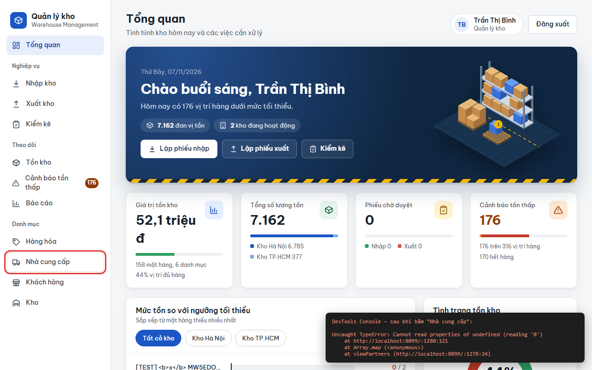
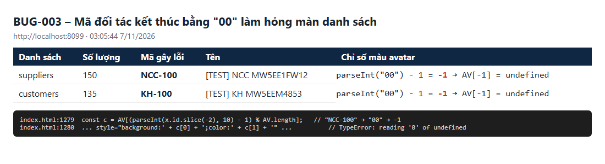

# BUG-003: Màn Nhà cung cấp / Khách hàng không mở được khi có đối tác mã kết thúc bằng "00" (ví dụ NCC-100)

| | |
| --- | --- |
| **Mức độ** | Major (cả hai màn danh sách đối tác không dùng được với mọi vai trò, không có cách đi vòng trên giao diện) |
| **Trạng thái** | Closed |
| **Liên quan** | Quản lý đối tác FR-04, FR-05 · màn Nhà cung cấp, Khách hàng · TC-SEC-02-01 (phát hiện gián tiếp) |
| **Môi trường** | local-H2, http://localhost:8099, Chromium headless, 07/11/2026 03:05 |
| **Phiên bản** | commit `aaaf02b` |
| **Vai trò** | admin, manager, staff (cả ba đều lỗi) |
| **Người ghi** | QA_QC (tự động: playwright-bdd, chạy song song) |
| **Ngày** | 2026-11-07 |

## Tóm tắt

Sau khi hệ thống có **nhà cung cấp thứ 100** (`NCC-100`) hoặc **khách hàng thứ 100** (`KH-100`), bấm menu **Nhà cung cấp** hoặc **Khách hàng** không có tác dụng gì. Màn hình vẫn đứng ở trang trước và không có thông báo lỗi nào.

Trong console có lỗi JavaScript `TypeError: Cannot read properties of undefined (reading '0')` ở hàm `viewPartners`. Màu avatar được chọn theo 2 chữ số cuối của mã đối tác; mã kết thúc bằng `00` cho chỉ số `-1`, nên toàn bộ danh sách không vẽ được.

Lỗi sẽ gặp lại ở mọi mốc tròn trăm (`NCC-200`, `KH-300`…). Khi dùng thật, chỉ cần đủ 100 nhà cung cấp là màn này hỏng vĩnh viễn, vì đối tác không xóa được.

## Bước tái hiện

1. Hệ thống có ít nhất 100 nhà cung cấp. Có thể tạo nhanh bằng API: `POST /api/partners {type:"sup", name:"…"}` lặp lại đến khi xuất hiện mã `NCC-100`. Khách hàng làm tương tự với `type:"cus"` để có `KH-100`.
2. Đăng nhập bất kỳ vai trò nào, ví dụ Quản lý kho `0902 222 222` / `123456`.
3. Bấm menu **Nhà cung cấp**.
4. Bấm menu **Khách hàng**.

## Kết quả thực tế

- Màn hình vẫn ở **Tổng quan**, menu không chuyển sang mục vừa bấm, không có thông báo lỗi.
- Console trình duyệt:

```
Uncaught TypeError: Cannot read properties of undefined (reading '0')
    at http://localhost:8099/:1280:121
    at Array.map (<anonymous>)
    at viewPartners (http://localhost:8099/:1278:24)
```

- Dữ liệu tại thời điểm lỗi:
  - 150 nhà cung cấp, trong đó có `NCC-100` (`[TEST] NCC MW5EE1FW12`);
  - 135 khách hàng, trong đó có `KH-100`.
- Đã thử cả 3 vai trò admin, manager, staff: màn **Nhà cung cấp** và **Khách hàng** đều hỏng, còn **Hàng hóa** vẫn mở bình thường.

**Ảnh chụp**

| | |
| --- | --- |
| Bấm "Nhà cung cấp": vẫn ở Tổng quan, console báo lỗi |  |
| Bấm "Khách hàng": cũng không mở |  |
| Mã gây lỗi và dòng code |  |

## Kết quả mong đợi

- Màn Nhà cung cấp và Khách hàng mở bình thường với bất kỳ số lượng và mã đối tác nào.
- Mỗi đối tác có một màu avatar hợp lệ.

## Test phát hiện

`e2e/features/02-bao-mat.feature` :: **SEC-02 › Tên đối tác chứa HTML không bị thực thi** (`@TC-SEC-02-01`), bước `tôi mở danh sách NCC…`.

- Lỗi test: `locator('#p-list .trow') … element(s) not found`. Sau khi `nav()` được sửa để kiểm tra màn hình đã chuyển chưa, test báo rõ hơn: `aside button.nav "Nhà cung cấp" … expected aria-current="page", received ""`.
- Lúc đầu lỗi trông như do chạy nhiều worker, nhưng thực ra không phải. Mỗi kịch bản có fixture tạo 1 nhà cung cấp và 1 khách hàng, nên số đối tác vượt mốc 100 trong khi chạy. Chạy 1 worker trên cùng dữ liệu cũng lỗi y hệt.
- Các test khác mở màn đối tác (`10-nha-cung-cap.feature`, `11-khach-hang.feature`) cũng sẽ lỗi trên CSDL này.

## Phân tích nguyên nhân

File: `src/main/resources/static/index.html`. Cùng một công thức xuất hiện ở 3 chỗ:

| Dòng | Hàm / nơi dùng | Code |
| --- | --- | --- |
| 1279 | `viewPartners`, danh sách đối tác | `const c = AV[(parseInt(x.id.slice(-2), 10) - 1) % AV.length];` |
| 1182 | chi tiết đối tác | `const c = AV[(parseInt(… .slice(-2), 10) - 1) % AV.length]` |
| 1620 | popup rê chuột (`#hpop`) | `const c = AV[(parseInt(pid.slice(-2), 10) - 1) % AV.length]` |

Với `NCC-100` thì `slice(-2)` là `"00"`, nên `parseInt` cho `0`, trừ 1 thành `-1`, và `-1 % AV.length` vẫn là `-1` (phép `%` của JavaScript giữ dấu). `AV[-1]` là `undefined`, nên `c[0]` ném `TypeError`. Hàm vẽ màn hình dừng giữa chừng nên giao diện đứng nguyên.

Hướng sửa gợi ý: dùng một hàm chung, luôn trả chỉ số không âm và dùng cả mã chứ không chỉ 2 chữ số cuối:

```js
const avOf = (id) => AV[(parseInt(String(id).replace(/\D/g, ''), 10) || 0) % AV.length];
// thay 3 chỗ: const c = avOf(x.id) / avOf(pid) …
```

Nên kiểm tra thêm các chỗ khác lấy phần tử mảng theo chỉ số tính từ mã.

## Đóng

- Commit sửa: `00fdf23` Fix BUG-001..011 (nhánh main, github.com/khanhle1511/Quan_Li_Kho_Hang)
- Ngày đóng: 2026-11-07
- Kiểm tra lại bằng: `TC-SEC-02-01` và toàn bộ `10-nha-cung-cap.feature`, `11-khach-hang.feature` trên CSDL có từ 100 đối tác trở lên
- Cách sửa: thêm hàm chung `avOf(id)` trong `index.html` (cạnh mảng `AV`) lấy toàn bộ phần số của mã và kẹp chỉ số ≥ 0; thay ở 3 chỗ: danh sách đối tác (`viewPartners`), chi tiết đối tác (`viewPartnerDetail`), popup rê chuột (`hpHtml`). Màu của mã 001–099 giữ nguyên như cũ.
- Kết quả kiểm tra lại (07/11/2026, local-H2 cổng 8097, CSDL có 103 NCC và 103 KH gồm NCC-100, KH-100): TC-SEC-02-01 đạt; toàn bộ `10-nha-cung-cap.feature` và `11-khach-hang.feature` đạt (trừ TC-SUP-06-06 thất bại vì lỗi khác đã biết: tên file PDF 300 ký tự trả 500, không liên quan bug này).
