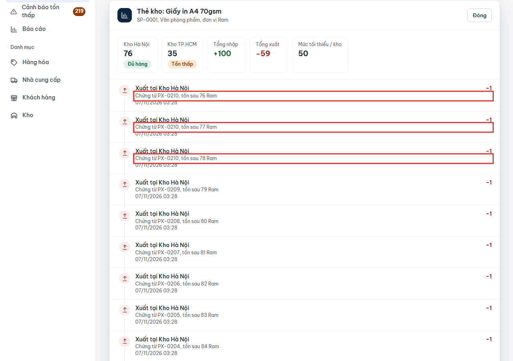
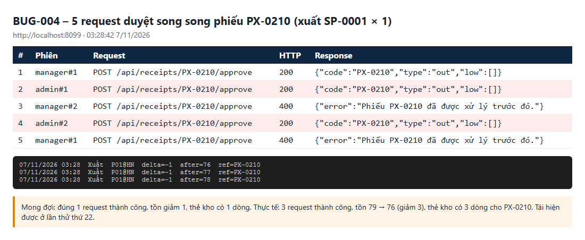

# BUG-004: Duyệt cùng một phiếu đồng thời thì phiếu được duyệt nhiều lần, tồn bị trừ/cộng nhiều lần

| | |
| --- | --- |
| **Mức độ** | Critical (sai số tồn kho, thẻ kho ghi trùng chứng từ) |
| **Trạng thái** | Closed |
| **Liên quan** | RISK-01 · BR-09, BR-10 (duyệt phiếu cập nhật tồn, ghi thẻ kho) · UC04 Duyệt phiếu · TC-RCPT-09-01 |
| **Môi trường** | local-H2, http://localhost:8099, 07/11/2026 03:28 |
| **Phiên bản** | commit `aaaf02b` |
| **Vai trò** | manager, admin (2 người duyệt bấm cùng lúc, hoặc 1 người bấm 2 lần, hoặc 2 tab) |
| **Người ghi** | QA_QC (tự động: playwright-bdd) |
| **Ngày** | 2026-11-07 |

## Tóm tắt

Khi nhiều request duyệt **cùng một phiếu** đến máy chủ gần như cùng lúc, có thể nhiều request cùng được chấp nhận. Mỗi request đó cộng hoặc trừ tồn một lần và ghi thêm một dòng thẻ kho cho cùng một chứng từ.

Ví dụ tái hiện được: phiếu xuất **PX-0210** chỉ có 1 Ram giấy nhưng được duyệt **3 lần**. Tồn tại Kho Hà Nội giảm từ **79 xuống 76**, và thẻ kho có **3 dòng "Xuất – Chứng từ PX-0210"**.

Lỗi xảy ra ngẫu nhiên tùy thời điểm: khoảng 1 trong 10 đến 1 trong 20 lần thử. Thực tế nó xảy ra khi hai quản lý cùng bấm "Duyệt", khi bấm đúp, hoặc khi mạng chậm khiến trình duyệt gửi lại.

## Bước tái hiện

1. Nhân viên kho (`0903 333 333`) lập phiếu **xuất** `P01 – Giấy in A4 70gsm × 1` từ Kho Hà Nội cho khách hàng `KH-01`. Phiếu được mã `PX-xxxx`.
2. Ghi lại tồn `P01` tại Kho Hà Nội, gọi là `t`.
3. Từ 4 phiên đăng nhập (2 phiên Quản lý kho, 2 phiên Admin), gửi **cùng lúc 5 request** `POST /api/receipts/PX-xxxx/approve`.
4. Đọc lại tồn và thẻ kho của `P01` tại Kho Hà Nội.
5. Nếu chỉ có 1 request thành công thì lặp lại từ bước 1. Script tái hiện được ở lần thử thứ 22; test BDD lặp 10 lần thì lỗi 1 lần.

## Kết quả thực tế

| # | Phiên | HTTP | Response |
| --- | --- | --- | --- |
| 1 | manager#1 | 200 | `{"code":"PX-0210","type":"out","low":[]}` |
| 2 | admin#1 | **200** | `{"code":"PX-0210","type":"out","low":[]}` |
| 3 | manager#2 | 400 | `{"error":"Phiếu PX-0210 đã được xử lý trước đó."}` |
| 4 | admin#2 | **200** | `{"code":"PX-0210","type":"out","low":[]}` |
| 5 | manager#1 | 400 | `{"error":"Phiếu PX-0210 đã được xử lý trước đó."}` |

Thẻ kho:

```
07/11/2026 03:28  Xuất  P01@HN  delta=-1  after=78  ref=PX-0210
07/11/2026 03:28  Xuất  P01@HN  delta=-1  after=77  ref=PX-0210
07/11/2026 03:28  Xuất  P01@HN  delta=-1  after=76  ref=PX-0210
```

Phiếu xuất 1 đơn vị nhưng tồn bị trừ 3 (79 → 76). Báo cáo "Tổng xuất" của mặt hàng cũng bị tính dư 2.

**Ảnh chụp**

| | |
| --- | --- |
| Thẻ kho: 3 dòng cùng chứng từ PX-0210 |  |
| Nhật ký 5 request duyệt và dòng thẻ kho |  |

## Kết quả mong đợi

- Đúng **1** request duyệt thành công. Các request còn lại nhận 400 `Phiếu … đã được xử lý trước đó.` (hoặc 409).
- Tồn thay đổi đúng bằng số lượng trên phiếu, một lần.
- Thẻ kho có đúng **1** dòng cho mỗi mặt hàng của phiếu.

## Test phát hiện

`e2e/features/04-nhap-xuat-kho.feature` :: **RCPT-09 › Duyệt cùng một phiếu đồng thời** (`@TC-RCPT-09-01 @exclusive @risk`)

- Lỗi khi tái hiện: `statuses: 200,200,200,200,200`, `Expected length: 1, Received length: 5`.
- Vì lỗi phụ thuộc thời điểm, một lần chạy có thể đạt. Nên chạy lặp:
  `cd e2e && BASE_URL=http://localhost:8099 npx playwright test --project=bdd --workers=1 --repeat-each=20 -g "TC-RCPT-09-01"`

## Phân tích nguyên nhân

File / hàm: `src/main/java/com/qlkho/service/InventoryService.java`, `approve()` (khoảng dòng 140–175) và `pendingReceipt()`.

- `pendingReceipt()` đọc phiếu, thấy trạng thái `pending` thì cho đi tiếp. Việc **kiểm tra rồi mới ghi** này không được bảo vệ: không khóa dòng (`@Lock(PESSIMISTIC_WRITE)` / `SELECT … FOR UPDATE`), entity `Receipt` không có `@Version`, và không có câu `UPDATE … WHERE status='pending'` có điều kiện.
- Các transaction chạy song song đều đọc thấy `pending` trước khi transaction đầu tiên commit `approved`. Vì vậy request nào cũng cộng/trừ tồn qua `move()` và ghi `StockHistory`.
- `Stock` cũng không có `@Version`, nên ngoài việc duyệt trùng còn có thể mất cập nhật tồn khi hai phiếu khác nhau cùng đụng một mặt hàng.

Hướng sửa gợi ý (chọn một):

1. Thêm repository method `@Lock(LockModeType.PESSIMISTIC_WRITE) Optional<Receipt> findForUpdateById(String id)` và dùng nó trong `approve()`/`reject()`.
2. Hoặc thêm `@Version long version` vào `Receipt` và `Stock`. Khi gặp `OptimisticLockException` thì trả 400 `Phiếu … đã được xử lý trước đó.`
3. Hoặc chuyển trạng thái nguyên tử: `UPDATE phieu SET status='approved' WHERE id=? AND status='pending'`. Nếu số dòng cập nhật khác 1 thì từ chối, và chỉ cập nhật tồn khi bằng 1.

Ngoài ra nên khóa nút "Duyệt" trên giao diện trong lúc chờ phản hồi, nhưng vẫn phải sửa ở máy chủ.

## Đóng

- Commit sửa: `00fdf23` Fix BUG-001..011 (nhánh main, github.com/khanhle1511/Quan_Li_Kho_Hang)
- Ngày đóng: 2026-11-07
- Kiểm tra lại bằng: `TC-RCPT-09-01` lặp ≥ 50 lần (`--repeat-each=50`) không lần nào lỗi
- Cách sửa: `ReceiptRepo.finishPending()` là câu `UPDATE phieu SET status=?, approver_name=? WHERE id=? AND status='pending'`. `approve()`/`reject()` gọi nó (qua `InventoryService.finish()`) ngay sau khi kiểm tra quyền và **trước** khi đụng tồn; cập nhật khác 1 dòng thì trả 400 "Phiếu … đã được xử lý trước đó." CSDL khóa dòng khi UPDATE nên các request đồng thời chạy tuần tự và chỉ một request thấy `pending`. Nếu bước sau lỗi (không đủ tồn) thì transaction rollback, phiếu trở lại chờ duyệt. Ngoài ra `StockRepo.lockAllById()` (`SELECT … FOR UPDATE`, khóa theo thứ tự mã) được dùng khi duyệt và kiểm kê để hai phiếu khác nhau cùng đụng một mặt hàng không ghi đè tồn của nhau.
- Kết quả kiểm tra lại (07/11/2026, local-H2 cổng 8097): `TC-RCPT-09-01` lặp 50 lần: 50/50 đạt (đúng 1 request 200, tồn giảm đúng 1, thẻ kho 1 dòng). `TC-RCPT-09-03` (2 phiếu xuất cùng hàng duyệt song song) đạt. Toàn bộ `@TC-RCPT`, `@TC-STK` (45 test): 42 đạt, 1 bỏ qua, 2 thất bại không liên quan (TC-RCPT-04-01 cần CSDL mẫu nguyên bản; TC-STK-02-06 là RISK-04 đã thất bại từ trước).
