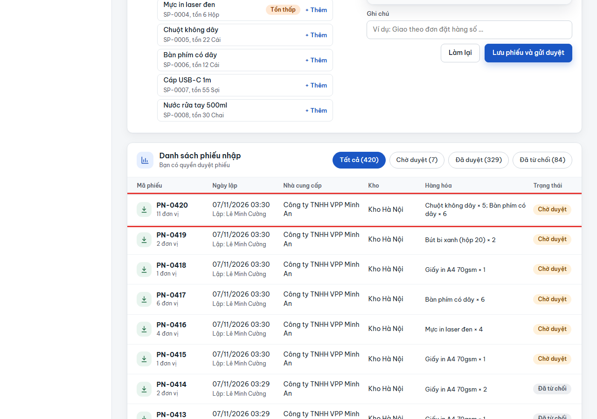
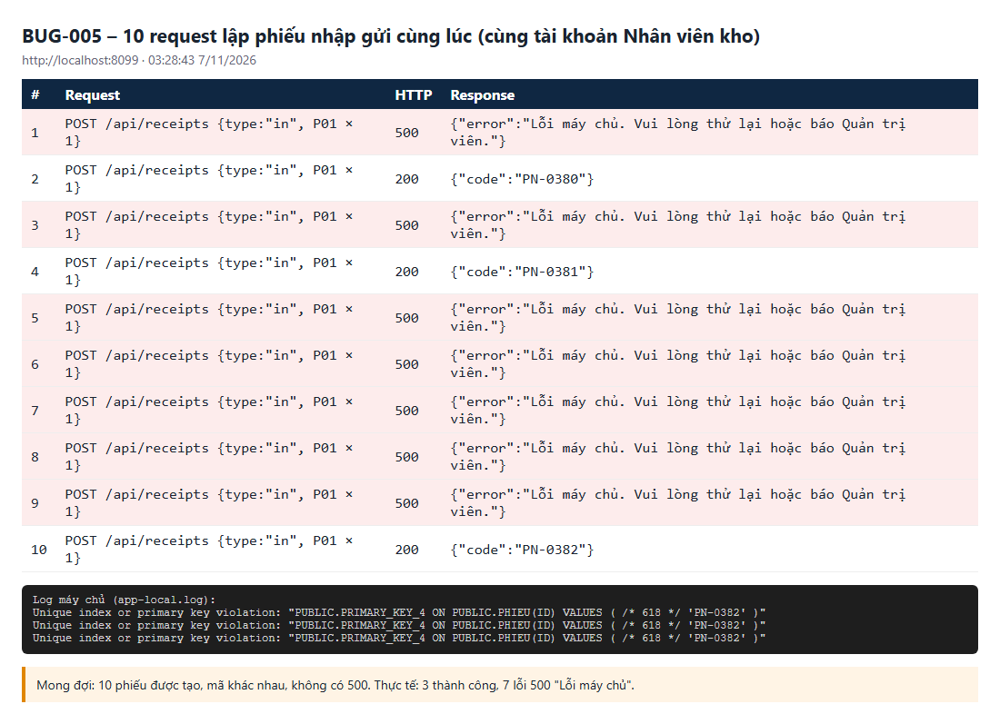
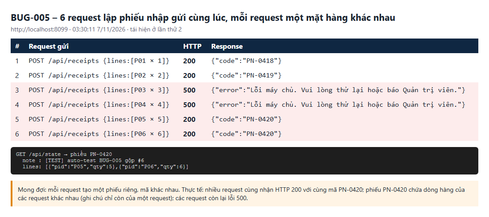

# BUG-005: Lập phiếu đồng thời thì bị lỗi 500, và các phiếu khác nhau bị gộp chung một mã

| | |
| --- | --- |
| **Mức độ** | Critical (mất phiếu; dòng hàng của người khác bị gộp vào phiếu của mình, duyệt sẽ sai tồn) |
| **Trạng thái** | Closed |
| **Liên quan** | RISK-02 · BR-05, BR-06 (lập phiếu, mã phiếu) · UC02, UC03 · TC-RCPT-09-02 |
| **Môi trường** | local-H2, http://localhost:8099, 07/11/2026 03:28–03:30 |
| **Phiên bản** | commit `aaaf02b` |
| **Vai trò** | staff (cũng xảy ra khi nhiều người khác nhau cùng lập phiếu) |
| **Người ghi** | QA_QC (tự động: playwright-bdd) |
| **Ngày** | 2026-11-07 |

## Tóm tắt

Khi nhiều phiếu nhập (hoặc xuất) được lập **cùng lúc**, máy chủ tính cùng một mã phiếu mới cho tất cả. Có hai hậu quả:

1. **Lỗi 500.** Phần lớn request nhận `Lỗi máy chủ. Vui lòng thử lại hoặc báo Quản trị viên.` Ở lần thử 10 request đồng thời, chỉ 3 phiếu được tạo, 7 request lỗi 500.
2. **Gộp phiếu không báo lỗi (nghiêm trọng hơn).** Có những request **cùng nhận HTTP 200 với cùng một mã**. Phiếu đó chứa dòng hàng của nhiều request khác nhau, còn ghi chú chỉ giữ của request cuối.
   - Ví dụ: request #5 (`P05 × 5`) và #6 (`P06 × 6`) đều nhận `{"code":"PN-0420"}`.
   - PN-0420 có 2 dòng `Chuột không dây × 5; Bàn phím có dây × 6`, ghi chú chỉ còn của #6.
   - Người lập #5 tưởng có phiếu riêng, nhưng thật ra hàng của họ nằm chung với phiếu khác.
   - Dữ liệu cũ cũng có 7 phiếu bị gộp như vậy, 2–3 dòng mỗi phiếu: PN-0383, 0393, 0394, 0396, 0400, 0404, 0408.

## Bước tái hiện

1. Đăng nhập Nhân viên kho (`0903 333 333` / `123456`).
2. Gửi **cùng lúc** 6–10 request `POST /api/receipts` loại `in`:
   - nhà cung cấp `NCC-01`, Kho Hà Nội;
   - mỗi request một mặt hàng khác nhau: `P01 × 1`, `P02 × 2`, …, `P06 × 6`.
3. So sánh mã phiếu trong các response, rồi xem danh sách phiếu ở màn **Nhập kho** (hoặc `GET /api/state`).

## Kết quả thực tế

Lần A, 10 request cùng mặt hàng: `500, 200, 500, 200, 500, 500, 500, 500, 500, 200`. Chỉ 3 phiếu PN-0380, 0381, 0382 được tạo.

```
ERROR … com.qlkho.common.ApiErrors : Lỗi không xử lý được
org.springframework.dao.DataIntegrityViolationException: could not execute statement
  [Unique index or primary key violation: "PUBLIC.PRIMARY_KEY_4 ON PUBLIC.PHIEU(ID) VALUES ( /* 618 */ 'PN-0382' )"]
```

Lần B, 6 request, mỗi request một mặt hàng:

| # | Gửi | HTTP | Response |
| --- | --- | --- | --- |
| 1 | P01 × 1 | 200 | `{"code":"PN-0418"}` |
| 2 | P02 × 2 | 200 | `{"code":"PN-0419"}` |
| 3 | P03 × 3 | **500** | `Lỗi máy chủ…` |
| 4 | P04 × 4 | **500** | `Lỗi máy chủ…` |
| 5 | P05 × 5 | 200 | `{"code":"PN-0420"}` |
| 6 | P06 × 6 | 200 | `{"code":"PN-0420"}` ← **trùng mã** |

`GET /api/state` → PN-0420: `lines = [{P05, 5}, {P06, 6}]`, `note = "… gộp #6"`.

**Ảnh chụp**

| | |
| --- | --- |
| Màn Nhập kho: PN-0420 chứa hàng của 2 request khác nhau (11 đơn vị) |  |
| 10 request đồng thời: 7 lỗi 500, log trùng khóa chính |  |
| 6 request: 2 request cùng nhận PN-0420, phiếu gộp dòng |  |

## Kết quả mong đợi

- Mỗi request lập phiếu hợp lệ tạo **một phiếu riêng**, mã không trùng, không có 500.
- Nếu không cấp được mã thì trả lỗi rõ ràng (409/400) để người dùng thử lại, và tuyệt đối không ghi vào phiếu của người khác.

## Test phát hiện

`e2e/features/04-nhap-xuat-kho.feature` :: **RCPT-09 › Tạo nhiều phiếu đồng thời** (`@TC-RCPT-09-02 @exclusive @risk`)

- Lỗi test: `statuses: 200,500,200,500,200,200,500,500,500,500`, `Expected length: 10, Received length: 4`.
- Nên bổ sung bước kiểm tra "không có 2 response 200 trùng mã" và "mỗi phiếu chỉ có dòng của chính request đó" để bắt được trường hợp gộp phiếu.

## Phân tích nguyên nhân

File / hàm: `src/main/java/com/qlkho/service/InventoryService.java`, `create()` (khoảng dòng 116–131), và `Rules.nextCode()`.

```java
String code = Rules.nextCode(receipts.findIdsByPrefix(prefix), prefix, 4);  // max + 1, không khóa
r.id = code;
receipts.save(r);                    // id gán tay → Spring Data coi là entity cũ → em.merge()
lines.saveAll(... ReceiptLine.of(code, ...));
```

1. **Mã sinh theo "lấy mã lớn nhất + 1"** ở tầng ứng dụng, không có khóa hay sequence. Các transaction đồng thời đọc cùng mã lớn nhất nên đều ra cùng mã mới.
2. **`receipts.save(r)` với id gán tay sẽ gọi `merge`, không phải `persist`.** `merge` SELECT theo id trước:
   - Nếu phiếu kia **chưa** commit thì cả hai cùng INSERT, và CSDL chặn bằng lỗi trùng khóa chính → 500 (hậu quả 1).
   - Nếu phiếu kia **đã** commit thì `merge` biến thành **UPDATE ghi đè** phiếu cũ (ghi chú, đối tác, kho…), rồi `lines.saveAll` **thêm** dòng mới vào phiếu đó. Request vẫn trả 200 với mã trùng (hậu quả 2).

Hướng sửa gợi ý:

- Sinh mã bằng sequence của CSDL, hoặc bảng đếm có khóa (`SELECT … FOR UPDATE`), hoặc thử lại khi trùng khóa.
- Dùng `entityManager.persist()` (hoặc cho `Receipt` implement `Persistable` với `isNew() = true`) để không bao giờ ghi đè phiếu đã có. Trùng mã thì phải lỗi, không được gộp.
- Áp dụng cho cả mã phiếu kiểm kê, mã đối tác, mã hàng nếu dùng cùng `Rules.nextCode`.

## Đóng

- Commit sửa: `00fdf23` Fix BUG-001..011 (nhánh main, github.com/khanhle1511/Quan_Li_Kho_Hang)
- Ngày đóng: 2026-11-07
- Kiểm tra lại bằng: `TC-RCPT-09-02` (thêm kiểm tra không trùng mã, không gộp dòng), lặp ≥ 20 lần
- Cách sửa: `InventoryService.withNewCode()` chạy phần lập phiếu / kiểm kê trong `TransactionTemplate` dưới một `ReentrantLock` giữ suốt transaction (kể cả commit), nên việc "lấy mã lớn nhất + 1" và ghi phiếu chạy tuần tự trong một máy chủ. Phiếu và phiếu kiểm kê được ghi bằng `em.persist()` thay cho `save()` (merge), nên trùng mã thì CSDL báo trùng khóa chính thay vì ghi đè/gộp vào phiếu đã có; khi đó thử lại tối đa 3 lần với mã mới, vẫn trùng thì trả 409 "Hệ thống đang bận, vui lòng thử lại." thay vì 500. Chưa áp dụng cho mã đối tác / hàng hóa / tài khoản (`CatalogService`, `UserService`) – các mã này ít bị tạo đồng thời; nếu cần có thể dùng lại `withNewCode`.
- Kết quả kiểm tra lại (07/11/2026, local-H2 cổng 8097): `TC-RCPT-09-02` lặp 20 lần: 20/20 đạt (10 request đồng thời → 10 phiếu, 10 mã khác nhau, không có 500). Log máy chủ sau hơn 100 lần chạy test không có dòng ERROR nào.
