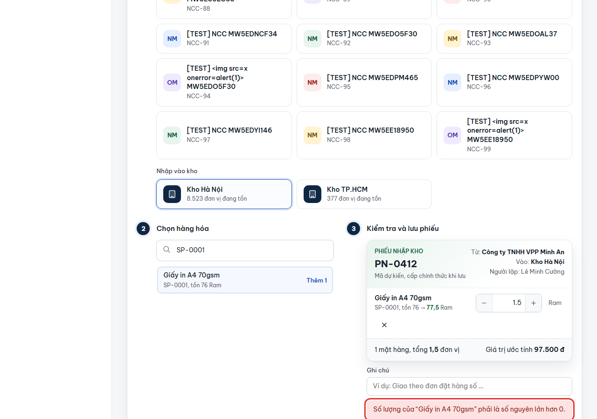
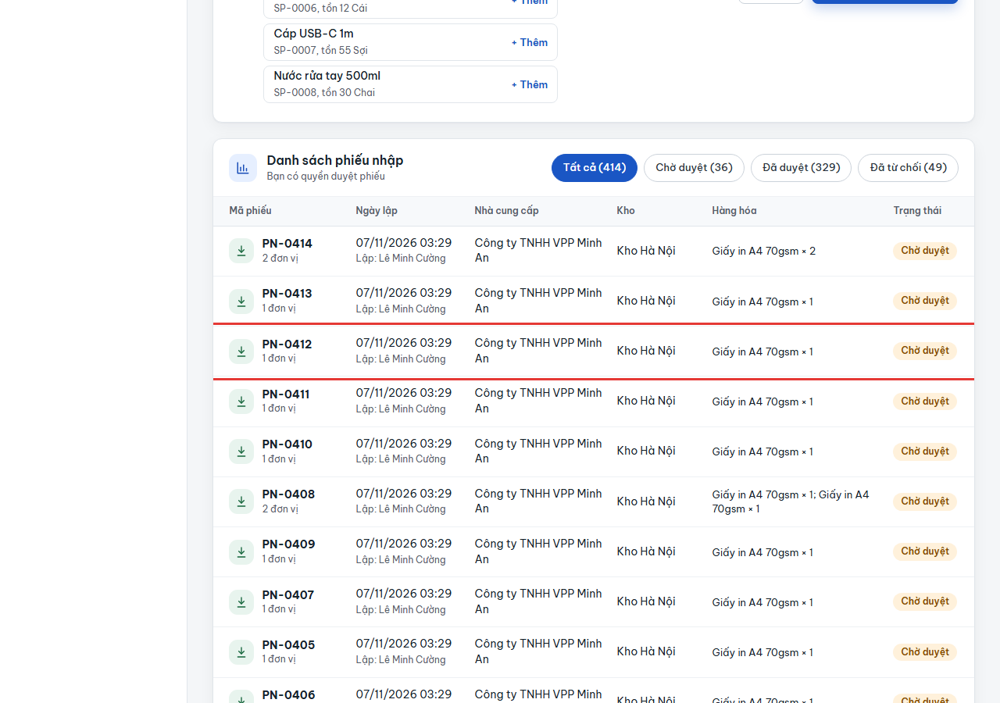
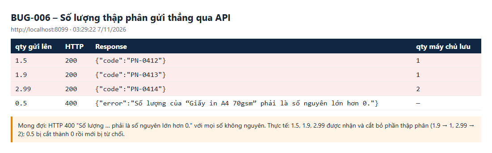

# BUG-006: API lập phiếu nhận số lượng thập phân (1.5) và cắt thành số nguyên mà không báo lỗi

| | |
| --- | --- |
| **Mức độ** | Minor (giao diện đã chặn; chỉ xảy ra khi gọi API trực tiếp, nhưng số lượng lưu sai mà không báo) |
| **Trạng thái** | Closed |
| **Liên quan** | RISK-14 · BR-05 (số lượng là số nguyên > 0) · UC02, UC03 · TC-RCPT-01-05 |
| **Môi trường** | local-H2, http://localhost:8099, 07/11/2026 03:29 |
| **Phiên bản** | commit `aaaf02b` |
| **Vai trò** | staff (mọi vai trò được lập phiếu) |
| **Người ghi** | QA_QC (tự động: playwright-bdd) |
| **Ngày** | 2026-11-07 |

## Tóm tắt

Máy chủ chưa kiểm tra số lượng phải là số nguyên. Gửi `qty` thập phân qua `POST /api/receipts` thì phiếu vẫn được tạo (HTTP 200), và phần thập phân **bị cắt bỏ không báo lỗi**:

- `1.5` và `1.9` được lưu thành `1`;
- `2.99` được lưu thành `2`;
- `0.5` bị cắt thành `0`, rồi mới bị từ chối với thông báo "phải là số nguyên lớn hơn 0".

Giao diện chặn đúng: nhập 1.5 rồi bấm lưu sẽ thấy `Số lượng … phải là số nguyên lớn hơn 0.` Lỗi chỉ xảy ra khi gọi API trực tiếp (tích hợp, script, công cụ). Người gửi tưởng phiếu ghi 1.9 nhưng thực tế là 1, và khi duyệt thì tồn cũng chỉ thay đổi 1.

## Bước tái hiện

1. Đăng nhập Nhân viên kho qua API: `POST /api/auth/login {"phone":"0903333333","password":"123456"}`.
2. Gửi `POST /api/receipts` với body:

   ```json
   {"type":"in","partnerId":"NCC-01","warehouseId":"HN","note":"…","lines":[{"productId":"P01","qty":1.5}]}
   ```

3. Lặp lại với `qty` = `1.9`, `2.99`, `0.5`.
4. Xem các phiếu vừa tạo ở màn **Nhập kho** hoặc qua `GET /api/state`.

## Kết quả thực tế

| qty gửi lên | HTTP | Response | qty được lưu |
| --- | --- | --- | --- |
| 1.5 | **200** | `{"code":"PN-0412"}` | **1** |
| 1.9 | **200** | `{"code":"PN-0413"}` | **1** |
| 2.99 | **200** | `{"code":"PN-0414"}` | **2** |
| 0.5 | 400 | `Số lượng của "Giấy in A4 70gsm" phải là số nguyên lớn hơn 0.` | — |

**Ảnh chụp**

| | |
| --- | --- |
| Giao diện chặn đúng khi nhập 1.5 (để đối chiếu) |  |
| Phiếu PN-0412 gửi qty 1.5 qua API được lưu "× 1" |  |
| Nhật ký API: 1.5 / 1.9 / 2.99 được nhận và cắt |  |

## Kết quả mong đợi

- Mọi `qty` không phải số nguyên dương bị từ chối **HTTP 400** với `Số lượng của "…" phải là số nguyên lớn hơn 0.`, giống kiểm tra phía giao diện.
- Máy chủ không tự làm tròn hay cắt số lượng.
- Áp dụng tương tự cho số thực tế khi kiểm kê (`POST /api/stocktakes`) và các trường số khác (tồn tối thiểu, sức chứa kho, giá).

## Test phát hiện

`e2e/features/04-nhap-xuat-kho.feature` :: **RCPT-01 › Số lượng thập phân 1.5 không được làm tròn** (`@TC-RCPT-01-05 @risk`)

- Lỗi test: `Expected: 400, Received: 200`, body `{"code":"PN-0334"}`.

## Phân tích nguyên nhân

File:

- `src/main/java/com/qlkho/web/Dto.java:11`: `public record Line(String productId, Integer qty) {}`
- `src/main/java/com/qlkho/service/InventoryService.java:109`: chỉ kiểm tra `l.qty() == null || l.qty() <= 0`.

Jackson mặc định cho phép ép số thực sang `Integer` (`DeserializationFeature.ACCEPT_FLOAT_AS_INT` bật sẵn) và **cắt phần thập phân**. Đến khi vào service, giá trị đã là `1`, nên kiểm tra số nguyên không còn tác dụng.

Hướng sửa gợi ý (chọn một):

- Tắt hẳn: `spring.jackson.deserialization.accept-float-as-int=false` trong `application.properties`. Khi đó JSON `1.5` gây lỗi parse; cần bắt `HttpMessageNotReadableException` trong `ApiErrors` để trả 400 với thông báo dễ hiểu, không phải 500.
- Hoặc đổi `qty` sang `BigDecimal`/`Double` trong DTO, rồi kiểm tra `stripTrailingZeros().scale() <= 0` trước khi chuyển sang `int`.

## Đóng

- Commit sửa: `00fdf23` Fix BUG-001..011 (nhánh main, github.com/khanhle1511/Quan_Li_Kho_Hang)
- Ngày đóng: 2026-11-07
- Kiểm tra lại bằng: `TC-RCPT-01-05`, thêm trường hợp 1.9, 2.99, 0.5 và kiểm kê với số thập phân
- Cách sửa: `application.properties` thêm `spring.jackson.deserialization.accept-float-as-int=false`, nên Jackson không còn cắt 1.5 → 1 cho mọi trường `Integer`/`Long` (qty, actual, minStock, capacity, price). Giá trị thập phân bị `ApiErrors` trả 400 `Dữ liệu gửi lên không hợp lệ.` – cùng thông báo với trường hợp sai kiểu đã có (`"abc"`, 2147483648, TC-RCPT-01-06), không phải thông báo có tên hàng như gợi ý trong báo cáo, vì lỗi được chặn ở bước đọc JSON trước khi vào service.
- Kết quả kiểm tra lại (07/11/2026, local-H2 cổng 8097): `TC-RCPT-01-05` đạt, `TC-RCPT-01-06` đạt; curl: qty 1.5 / 1.9 / 2.99 / 0.5 → 400, qty 2 → 200, stocktake actual 1.5 → 400, product minStock 2.5 → 400.
