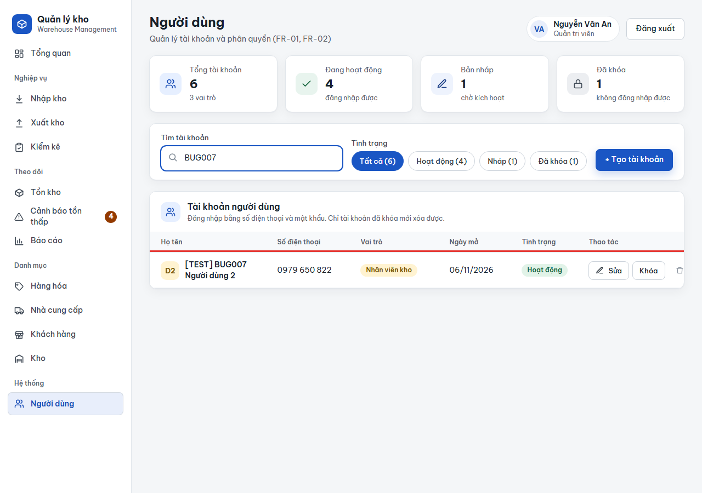
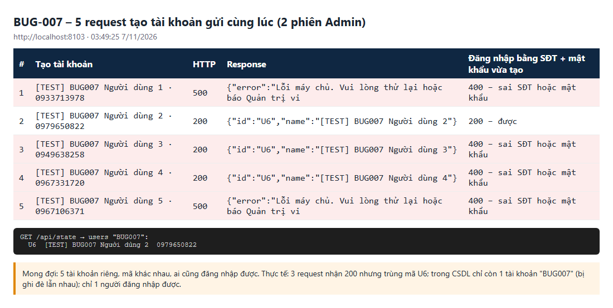

# BUG-007: Tạo tài khoản / đối tác / hàng hóa đồng thời thì trùng mã, lỗi 500 hoặc bản ghi bị ghi đè mà không báo

| | |
| --- | --- |
| **Mức độ** | Critical (mất tài khoản/đối tác vừa tạo dù API báo thành công; người dùng không đăng nhập được) |
| **Trạng thái** | Closed |
| **Liên quan** | Cùng nguyên nhân với BUG-005 (sinh mã "lớn nhất + 1" và `save()` với id gán tay) · FR-01, FR-02 Quản lý tài khoản · FR-04, FR-05 Đối tác · Hàng hóa · TC-STK-01-03 (phát hiện gián tiếp) |
| **Môi trường** | local-H2, agent3 http://localhost:8103 (CSDL mẫu vừa reset), 07/11/2026 03:49 |
| **Phiên bản** | commit `aaaf02b` |
| **Vai trò** | admin (tài khoản), manager/admin (đối tác, hàng hóa) |
| **Người ghi** | QA_QC (tự động: playwright-bdd, 4 worker) |
| **Ngày** | 2026-11-07 |

## Tóm tắt

Khi hai người (hoặc hai tab) cùng tạo **tài khoản**, **nhà cung cấp / khách hàng** hay **hàng hóa** gần như cùng lúc, máy chủ cấp **cùng một mã** cho các bản ghi mới. Kết quả là một trong hai trường hợp:

- **Lỗi 500** `Lỗi máy chủ…`: lỗi trùng khóa chính trong CSDL.
- **HTTP 200 nhưng dữ liệu bị ghi đè.** Mỗi request đều báo "tạo thành công" và trả cùng một id, nhưng trong CSDL chỉ còn một bản ghi. Những người khác **không đăng nhập được** bằng SĐT và mật khẩu vừa được cấp, vì tài khoản đó không còn tồn tại.

Ví dụ tái hiện: 5 Admin cùng tạo tài khoản. Có 3 request nhận 200, đều với `id: "U6"`, và 2 request nhận 500. Cuối cùng chỉ còn **1** tài khoản, và chỉ **1/5** người đăng nhập được.

## Bước tái hiện

1. Đăng nhập Admin ở 2 phiên (2 trình duyệt hoặc 2 tab).
2. Gửi cùng lúc 5 request `POST /api/users`. Mỗi request có họ tên, SĐT, mật khẩu khác nhau, `role: staff`, `status: active`.
3. So sánh id trong các response, rồi thử đăng nhập bằng từng SĐT/mật khẩu vừa tạo.
4. Làm tương tự với `POST /api/partners` (`type: sup`) và `POST /api/products`.

## Kết quả thực tế

**Tài khoản** (agent3, lần thử đầu tiên):

| # | Tạo tài khoản | HTTP | Response | Đăng nhập bằng SĐT + mật khẩu vừa tạo |
| --- | --- | --- | --- | --- |
| 1 | Người dùng 1 · 0933713978 | **500** | `Lỗi máy chủ…` | 400 |
| 2 | Người dùng 2 · 0979650822 | 200 | `{"id":"U6", "name":"… Người dùng 2"}` | 200 – được |
| 3 | Người dùng 3 · 0949638258 | **200** | `{"id":"U6", "name":"… Người dùng 3"}` | **400 – sai SĐT hoặc mật khẩu** |
| 4 | Người dùng 4 · 0967331720 | **200** | `{"id":"U6", "name":"… Người dùng 4"}` | **400 – sai SĐT hoặc mật khẩu** |
| 5 | Người dùng 5 · 0967106371 | **500** | `Lỗi máy chủ…` | 400 |

`GET /api/state` chỉ còn `U6 [TEST] BUG007 Người dùng 2 0979650822`.

**Đối tác** (6 request): 5 request nhận 200 đều với `NCC-05`, 1 request lỗi 500. Chỉ còn 1 nhà cung cấp, 4 nhà cung cấp "đã tạo" bị mất.

**Hàng hóa** (6 request): 3 request lỗi 500, và có 2 response 200 cùng `P15`.

Log máy chủ:

```
DataIntegrityViolationException: could not execute statement
  [Unique index or primary key violation: "PUBLIC.PRIMARY_KEY_E ON PUBLIC.NGUOI_DUNG(ID) VALUES ( /* 6 */ 'U6' )"]
```

**Ảnh chụp**

| | |
| --- | --- |
| Màn Người dùng: tìm "BUG007" chỉ còn 1 tài khoản (3 request đã báo thành công) |  |
| 5 request tạo tài khoản: 200 trùng mã U6, 500, chỉ 1 người đăng nhập được |  |

## Kết quả mong đợi

- Mỗi request tạo hợp lệ sinh **một bản ghi riêng**, mã không trùng.
- Không request nào trả 500.
- Nếu không cấp được mã thì trả lỗi rõ ràng để người dùng thử lại. **Không bao giờ** báo 200 rồi để mất dữ liệu.

## Test phát hiện

`e2e/features/05-kiem-ke.feature` :: **STK-01 › Kho tạm ngưng không có trong danh sách chọn kho** (`@TC-STK-01-03`). Bước `Cho fixture [TEST] đã được tạo` lỗi với `tạo user: {"error":"Lỗi máy chủ…"} Expected 200, Received 500`.

- Test này chỉ lỗi khi chạy **nhiều worker**: 4 kịch bản cùng dựng fixture nên cùng tạo tài khoản và đối tác một lúc. Chạy 1 worker thì đạt.
- Đây không phải lỗi của test. Môi trường nhiều người dùng thật cũng sẽ gặp đúng tình huống này.

Gợi ý bổ sung test riêng: `@exclusive`, tạo đồng thời N tài khoản / đối tác / hàng hóa, kiểm tra id khác nhau và ai cũng đăng nhập được.

## Phân tích nguyên nhân

Cùng một mẫu code ở nhiều chỗ:

| Đối tượng | Nơi sinh mã | Lưu |
| --- | --- | --- |
| Tài khoản | `UserService.create()`: `Rules.nextCode(users.findAllIds(), "U", 1)` | `users.save(u)` |
| Hàng hóa | `CatalogService` dòng 60: `Rules.nextCode(products.findAllIds(), "P", 2)` | `products.save(p)` dòng 67 |
| Đối tác | `CatalogService` dòng 101: `Rules.nextCode(partners.findIdsByPrefix(prefix), prefix, 2)` | `partners.save(p)` dòng 112 |
| Phiếu nhập/xuất | xem BUG-005 | |
| Phiếu kiểm kê | `InventoryService` dòng 198: `Rules.nextCode(stocktakes.findAllIds(), "KK-", 4)` | `stocktakes.save(s)` |

1. Mã mới được tính bằng **mã lớn nhất + 1** ở tầng ứng dụng, không có khóa hay sequence. Các request đồng thời ra cùng mã.
2. Id được gán tay nên `repository.save()` gọi **`merge`**:
   - Nếu bản ghi trùng **chưa** commit thì cả hai cùng INSERT, gây lỗi trùng khóa và trả 500.
   - Nếu bản ghi trùng **đã** commit thì `merge` thành **UPDATE ghi đè** họ tên, SĐT, **mật khẩu**… của bản ghi trước, rồi vẫn trả 200.

Hướng sửa gợi ý (dùng chung cho BUG-005):

- Sinh mã bằng sequence của CSDL, hoặc bảng đếm có khóa, hoặc bắt lỗi trùng khóa rồi thử lại.
- Tạo mới bằng `persist` (`EntityManager.persist` hoặc entity implement `Persistable` với `isNew() = true`) để trùng mã thì **lỗi**, không **ghi đè**.
- Đặt `UNIQUE` cho SĐT tài khoản và SKU hàng hóa ở CSDL (nếu chưa có) để chặn thêm một lớp.

## Đóng

- Commit sửa: `00fdf23` Fix BUG-001..011 (nhánh main, github.com/khanhle1511/Quan_Li_Kho_Hang)
- Ngày đóng: 2026-11-07
- Kiểm tra lại bằng: chạy `05-kiem-ke.feature` với 4 worker (`TC-STK-01-03` không lỗi fixture) và test đồng thời mới cho tài khoản, đối tác, hàng hóa
- Cách sửa: tách phần khóa + thử lại của BUG-005 thành component dùng chung `service/CreateTx.java` (`run()`: một khóa giữ suốt transaction kể cả commit, trùng khóa thì thử lại tối đa 3 lần rồi trả 409; `insert()`: `EntityManager.persist`, luôn INSERT). `UserService.create()`, `CatalogService.createProduct()/createPartner()/createWarehouse()` và `InventoryService.createReceipt()/stocktake()` đều chạy qua `CreateTx.run()` và ghi bằng `CreateTx.insert()`. Nhờ khóa, các kiểm tra trùng SĐT / SKU / mã kho cũng không còn bị xen kẽ.
- Kết quả kiểm tra lại (07/11/2026, local-H2 cổng 8097, CSDL mới): bắn đồng thời 8 request tạo tài khoản → 8×200, mã U6–U13 khác nhau, cả 8 SĐT đăng nhập được; 8 nhà cung cấp → NCC-04…NCC-11; 8 hàng hóa → P09…P16; 2 tài khoản cùng SĐT đồng thời → 1×200 + 1×400 "đã được dùng" (không còn 500/ghi đè). `05-kiem-ke.feature` chạy 4 worker: TC-STK-01-03 và các fixture [TEST] tạo song song không còn lỗi 500 (11 đạt, 1 bỏ qua; TC-STK-01-01 lỗi đếm số dòng vì worker khác thêm hàng hóa cùng lúc, không liên quan). Toàn bộ BDD 171 test, 1 worker: 165 đạt, 4 bỏ qua, 2 thất bại là RISK có từ trước (TC-SUP-06-06 tên file 300 ký tự, TC-USR-06-01 RISK-06).
