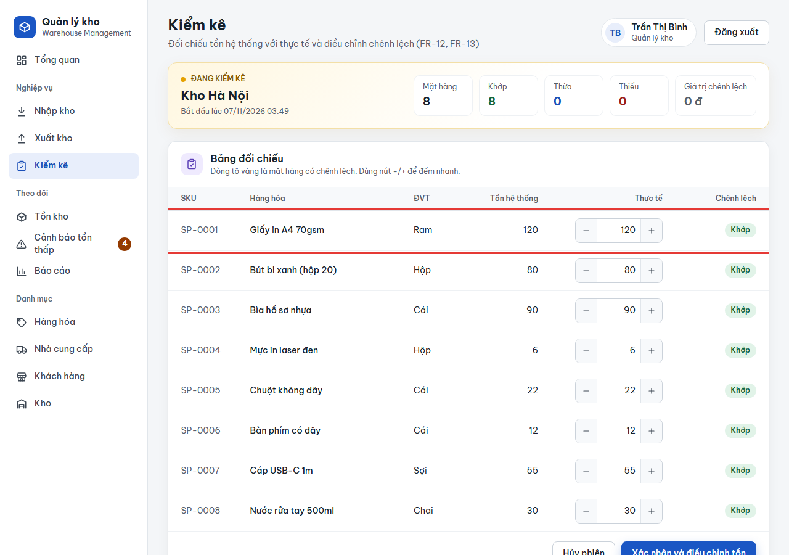
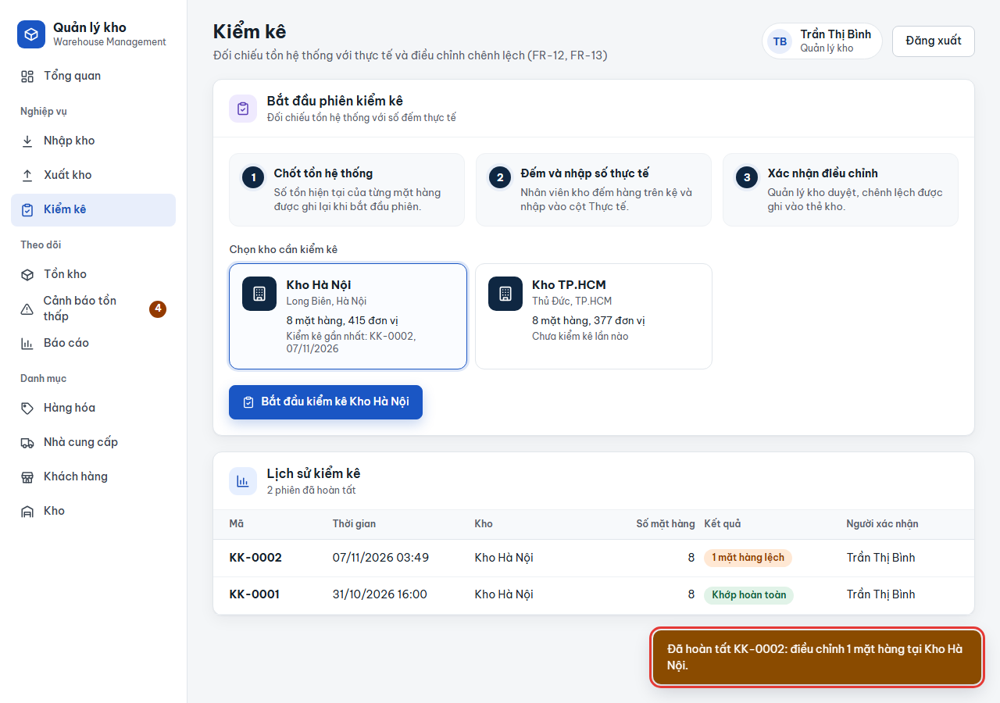
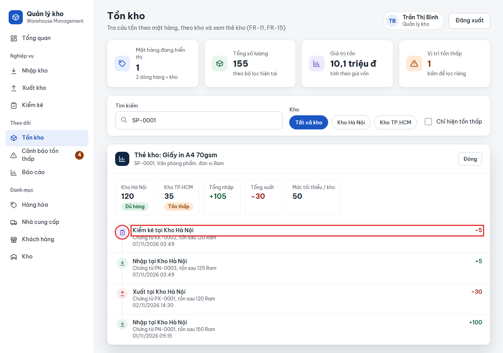
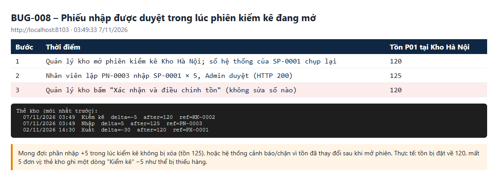

# BUG-008: Xác nhận kiểm kê xóa mất biến động tồn xảy ra trong lúc phiên kiểm kê đang mở

| | |
| --- | --- |
| **Mức độ** | Major (sai số tồn sau kiểm kê; thẻ kho ghi "thiếu hàng" không có thật) |
| **Trạng thái** | Closed |
| **Liên quan** | RISK-04 · BR-13 (kiểm kê điều chỉnh tồn) · UC05 Kiểm kê · F4, F6 · TC-STK-02-06 |
| **Môi trường** | local-H2, agent1 http://localhost:8101 (BDD) và agent3 http://localhost:8103 (tái hiện), 07/11/2026 03:49 |
| **Phiên bản** | commit `aaaf02b` |
| **Vai trò** | manager (xác nhận kiểm kê), staff + admin (lập và duyệt phiếu nhập trong lúc đó) |
| **Người ghi** | QA_QC (tự động: playwright-bdd) |
| **Ngày** | 2026-11-07 |

## Tóm tắt

Phiên kiểm kê lấy "số hệ thống" lúc **bắt đầu**. Khi xác nhận, máy chủ **đặt tồn bằng đúng số thực tế** người dùng gửi lên, mà không so với tồn hiện tại.

Nếu trong lúc phiên đang mở có phiếu nhập hoặc xuất được duyệt, thì khi xác nhận kiểm kê (dù không sửa số nào), biến động đó **bị xóa**. Thẻ kho còn ghi thêm một dòng "Kiểm kê" ngược dấu, như thể kho bị thiếu hoặc thừa hàng.

Ví dụ: tồn SP-0001 tại Kho Hà Nội là **120**. Mở phiên kiểm kê, rồi nhập thêm 5 (PN-0003 được duyệt) thành **125**. Bấm "Xác nhận và điều chỉnh tồn" mà không sửa gì thì tồn về **120**, thẻ kho có dòng `Kiểm kê −5 (KK-0002)`.

## Bước tái hiện

1. Quản lý kho (`0902 222 222`) vào **Kiểm kê**, chọn **Kho Hà Nội**, bấm **Bắt đầu kiểm kê**. Dòng SP-0001 hiện số hệ thống 120.
2. **Giữ nguyên phiên.** Ở phiên khác, Nhân viên kho lập phiếu nhập `SP-0001 × 5` vào Kho Hà Nội, Admin duyệt. Tồn thành 125.
3. Quay lại phiên kiểm kê, **không sửa số nào**, bấm **Xác nhận và điều chỉnh tồn**.
4. Xem **Tồn kho → SP-0001 → Thẻ kho**.

## Kết quả thực tế

| Bước | Tồn SP-0001 tại Kho Hà Nội |
| --- | --- |
| Mở phiên kiểm kê | 120 |
| PN-0003 (+5) được duyệt | 125 |
| Xác nhận kiểm kê không sửa số | **120** (mất 5) |

- Toast: `Đã hoàn tất KK-0002: điều chỉnh 1 mặt hàng tại Kho Hà Nội.` Hệ thống coi như có chênh lệch, dù người kiểm kê không sửa gì.
- Thẻ kho (mới nhất trước):

```
07/11/2026 03:49  Kiểm kê  delta=-5  after=120  ref=KK-0002
07/11/2026 03:49  Nhập     delta=+5  after=125  ref=PN-0003
02/11/2026 14:30  Xuất     delta=-30 after=120  ref=PX-0001
```

**Ảnh chụp**

| | |
| --- | --- |
| 1. Mở phiên kiểm kê Kho Hà Nội, SP-0001 = 120 |  |
| 2. Xác nhận không sửa số: "điều chỉnh 1 mặt hàng" |  |
| 3. Thẻ kho: Nhập +5 rồi Kiểm kê −5 ngay sau |  |
| 4. Diễn biến tồn qua từng bước |  |

## Kết quả mong đợi

Cần chốt quy tắc nghiệp vụ (đặc tả ghi "cần quyết định nghiệp vụ" ở RISK-04). Phương án an toàn nhất là một trong hai:

- **A. Điều chỉnh theo chênh lệch.** Gửi kèm số hệ thống lúc mở phiên. Máy chủ chỉ cộng/trừ phần `thực tế − số hệ thống lúc mở phiên`, nên giữ được biến động trong lúc kiểm kê. Ở ví dụ trên, tồn vẫn là 125.
- **B. Chặn và báo.** Nếu tồn hiện tại khác số hệ thống lúc mở phiên, trả 409/400 với thông báo `Tồn của SP-0001 đã thay đổi từ 120 thành 125 trong lúc kiểm kê, vui lòng kiểm tra lại`. Giao diện cập nhật lại số hệ thống để người kiểm kê đếm lại.

Dù chọn cách nào, xác nhận mà **không sửa số** cũng không được tạo dòng "Kiểm kê" trên thẻ kho.

## Test phát hiện

`e2e/features/05-kiem-ke.feature` :: **STK-02 › Biến động xảy ra trong lúc kiểm kê** (`@TC-STK-02-06 @risk`)

- Lỗi test: `tồn sau khi xác nhận kiểm kê bị đặt về số cũ, mất phần nhập trong lúc kiểm kê – Expected 55, Received 50` (agent1, 4 worker). Chạy 1 worker cũng lỗi tương tự, vì lỗi không phụ thuộc chạy song song.

## Phân tích nguyên nhân

File:

- `src/main/java/com/qlkho/web/Dto.java:15`: `record CountRow(String productId, Integer actual)`. Request chỉ có số thực tế, **không** có số hệ thống lúc mở phiên.
- `src/main/java/com/qlkho/service/InventoryService.java` (khoảng dòng 199–208), hàm xác nhận kiểm kê:

```java
Map<String, Stock> stk = stocksOf(pids, w.id);     // tồn HIỆN TẠI (đã gồm +5)
...
if (actual != s.qty) { move(s, actual, "Kiểm kê", code, t); diff++; }   // đặt tồn = actual
```

Máy chủ so số thực tế với tồn **hiện tại**, không phải tồn lúc mở phiên, nên mọi biến động trong lúc kiểm kê đều bị xem là chênh lệch kiểm kê và bị xóa. Phiên kiểm kê chỉ nằm trong bộ nhớ trang (RISK-12), nên máy chủ không biết phiên bắt đầu lúc nào.

Hướng sửa gợi ý cho phương án A hoặc B: thêm `Integer system` (số hệ thống lúc mở phiên) vào `CountRow`, rồi:

- A: `after = s.qty + (actual - system)`.
- B: nếu `s.qty != system` thì báo lỗi.

## Đóng

- Commit sửa: `00fdf23` Fix BUG-001..011 (nhánh main, github.com/khanhle1511/Quan_Li_Kho_Hang)
- Ngày đóng: 2026-11-07
- Kiểm tra lại bằng: `TC-STK-02-06` (cập nhật kỳ vọng theo phương án đã chốt)
- Quy tắc đã chốt: **phương án A – điều chỉnh theo chênh lệch** (giống cách "đóng băng số sách" khi kiểm kê). Giao diện gửi kèm `system` = số hệ thống lúc mở phiên cho từng dòng (`Dto.CountRow(productId, actual, system)`); máy chủ tính `tồn mới = tồn hiện tại + (actual − system)`, chỉ ghi thẻ kho "Kiểm kê" khi chênh lệch ≠ 0. Phản hồi có thêm `moved` (danh sách mặt hàng có biến động trong lúc kiểm kê) và toast nhắc "biến động đó được giữ nguyên". Nếu chênh lệch làm tồn âm thì trả 400 "Tồn của … đã thay đổi trong lúc kiểm kê (từ a thành b)… Hãy đếm lại". Request không gửi `system` (gọi API trực tiếp, các test cũ) được hiểu là so với tồn hiện tại như trước.
- Test cập nhật: bước "cần quyết định nghiệp vụ về tồn T_PROD" trong `e2e/steps/receipts.steps.ts` nay kiểm tra tồn = t + 5 **và** dòng thẻ kho mới nhất là "Nhập" (không có dòng "Kiểm kê").
- Kết quả kiểm tra lại (07/11/2026, local-H2 cổng 8097): `TC-STK-02-06` lặp 3 lần: 3/3 đạt; toàn bộ `05-kiem-ke.feature` và các test kiểm kê khác (STK-02-01…04, RCPT-09-03 dùng kiểm kê để đặt tồn) vẫn đạt.
