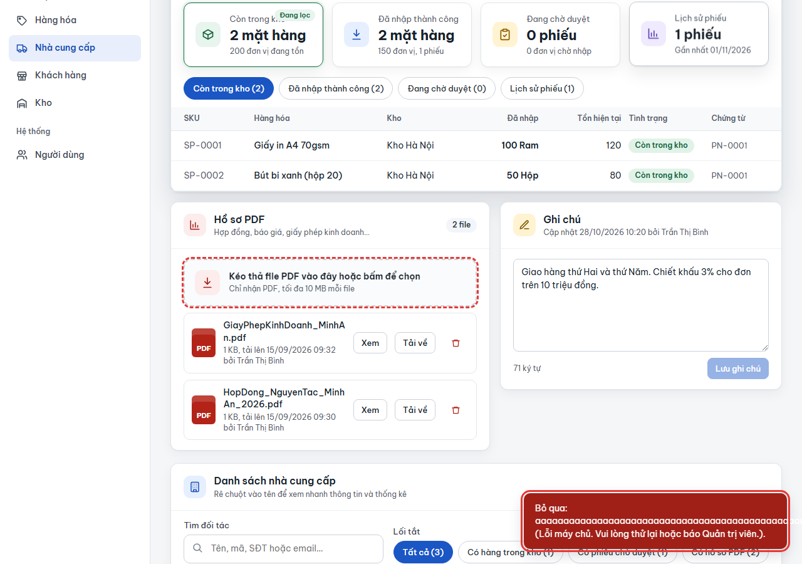
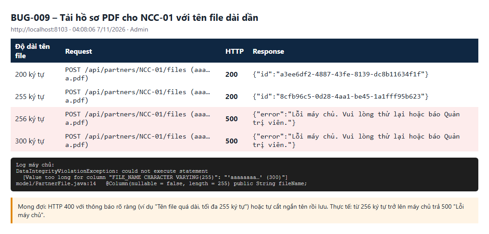

# BUG-009: Tải hồ sơ PDF có tên file dài hơn 255 ký tự thì lỗi 500

| | |
| --- | --- |
| **Mức độ** | Minor (file không lưu được, thông báo không cho biết lý do; dữ liệu khác không bị ảnh hưởng) |
| **Trạng thái** | Closed |
| **Liên quan** | RISK-15 · Hồ sơ PDF đối tác (FR-04, FR-05) · TC-SUP-06-06 |
| **Môi trường** | local-H2, agent1 http://localhost:8101 (BDD) và agent3 http://localhost:8103 (tái hiện), 07/11/2026 |
| **Phiên bản** | commit `aaaf02b` |
| **Vai trò** | admin (vai trò được tải hồ sơ theo bảng phân quyền 4.2; Quản lý kho nhận 403) |
| **Người ghi** | QA_QC (tự động: playwright-bdd) |
| **Ngày** | 2026-11-07 |

## Tóm tắt

Khi tải lên hồ sơ PDF cho nhà cung cấp hoặc khách hàng mà **tên file dài từ 256 ký tự trở lên**, máy chủ trả **HTTP 500** `Lỗi máy chủ. Vui lòng thử lại hoặc báo Quản trị viên.` Giao diện báo `Bỏ qua: <tên file> (Lỗi máy chủ…)`, và người dùng không biết là do tên file quá dài.

- Ngưỡng tính theo **ký tự**: 255 ký tự lưu được, 256 ký tự thì lỗi.
- Tên tiếng Việt có dấu dài 144 ký tự vẫn lưu được.

Phụ: tên file dài làm chữ trong thông báo **tràn ra ngoài khung** (xem ảnh 1).

## Bước tái hiện

1. Đăng nhập Admin (`0901 111 111` / `123456`).
2. Vào **Nhà cung cấp**, bấm **Chi tiết** ở `NCC-01`.
3. Ở mục **Hồ sơ PDF**, chọn một file PDF hợp lệ có tên dài 300 ký tự, ví dụ `aaaa…a.pdf`.

API tương đương: `POST /api/partners/NCC-01/files` (multipart, trường `file`).

## Kết quả thực tế

| Độ dài tên file | HTTP | Response |
| --- | --- | --- |
| 200 ký tự | 200 | `{"id":"a3ee6df2-…"}` |
| 255 ký tự | 200 | `{"id":"8cfb96c5-…"}` |
| **256 ký tự** | **500** | `{"error":"Lỗi máy chủ. Vui lòng thử lại hoặc báo Quản trị viên."}` |
| **300 ký tự** | **500** | như trên |

Giao diện: toast `Bỏ qua: aaaa…a.pdf (Lỗi máy chủ. Vui lòng thử lại hoặc báo Quản trị viên.).`, chữ tràn khỏi khung.

Log máy chủ:

```
ERROR … com.qlkho.common.ApiErrors : Lỗi không xử lý được
org.springframework.dao.DataIntegrityViolationException: could not execute statement
  [Value too long for column "FILE_NAME CHARACTER VARYING(255)": "'aaaaaaaa…' (300)"]
```

**Ảnh chụp**

| | |
| --- | --- |
| Tải file tên 300 ký tự ở chi tiết NCC-01: "Bỏ qua … Lỗi máy chủ", chữ tràn khung |  |
| API: 255 ký tự được, 256 ký tự trở lên lỗi 500 |  |

## Kết quả mong đợi

- Máy chủ kiểm tra độ dài tên file **trước khi lưu** và chọn một trong hai cách:
  - trả **HTTP 400** `Tên file quá dài (tối đa 255 ký tự). Vui lòng đổi tên rồi tải lại.`;
  - hoặc tự rút gọn tên (giữ đuôi `.pdf`) rồi lưu bình thường.
- Không bao giờ trả 500.
- Toast xuống dòng hoặc rút gọn tên file dài (`overflow-wrap: anywhere` hoặc dấu `…`), không tràn khung.

## Test phát hiện

`e2e/features/10-nha-cung-cap.feature` :: **SUP-06 › Tên file dài 300 ký tự được xử lý an toàn** (`@TC-SUP-06-06 @risk`, Khung kịch bản)

- Lỗi test: `phản hồi 500: {"error":"Lỗi máy chủ…"} – Expected value: 500, Received array: [200, 400]` (`e2e/steps/partners.steps.ts:182`).
- Lỗi xảy ra cả khi chạy 4 worker lẫn 1 worker.

## Phân tích nguyên nhân

File:

- `src/main/java/com/qlkho/model/PartnerFile.java:14`: `@Column(nullable = false, length = 255) public String fileName;`
- `src/main/java/com/qlkho/service/CatalogService.java:169`: `String name = Optional.ofNullable(mf.getOriginalFilename()).orElse("hoso.pdf");` rồi truyền thẳng vào `store()` (dòng 185, gán `pf.fileName = fileName` ở dòng 194). Không có bước kiểm tra độ dài nào.

CSDL từ chối giá trị dài hơn cột `VARCHAR(255)`. `ApiErrors` không bắt riêng `DataIntegrityViolationException` nên trả 500.

Hướng sửa gợi ý, trong `CatalogService` trước khi gọi `store()`:

```java
if (name.length() > 255) throw ApiException.bad("Tên file quá dài (tối đa 255 ký tự). Vui lòng đổi tên rồi tải lại.");
```

Hoặc rút gọn: giữ 250 ký tự đầu + `.pdf`. Nên áp dụng giới hạn tương tự cho các trường văn bản khác có `@Column(length = …)`: tên đối tác, ghi chú, địa chỉ… để không còn chỗ nào trả 500 vì dữ liệu dài.

## Đóng

- Commit sửa: `00fdf23` Fix BUG-001..011 (nhánh main, github.com/khanhle1511/Quan_Li_Kho_Hang)
- Ngày đóng: 2026-11-07
- Kiểm tra lại bằng: `TC-SUP-06-06`, thêm trường hợp 255 / 256 ký tự
- Cách sửa: `CatalogService.upload()` kiểm tra `name.length() > 255` (hằng `MAX_FILE_NAME`, bằng độ dài cột) trước khi lưu và trả 400 "Tên file quá dài (tối đa 255 ký tự). Vui lòng đổi tên rồi tải lại." Thêm lưới an toàn trong `ApiErrors`: `DataIntegrityViolationException` (giá trị dài hơn cột, vi phạm UNIQUE) nay trả 400 "Dữ liệu không hợp lệ: có trường quá dài so với giới hạn lưu trữ hoặc trùng với bản ghi khác." kèm log WARN, thay vì 500, nên các trường văn bản khác (ghi chú 2000, địa chỉ 200…) cũng không còn trả 500. Toast thêm `overflow-wrap:anywhere` để tên file dài không tràn khung.
- Test cập nhật: `TC-SUP-06-06` thêm trường hợp 255 và 256 ký tự; step "Admin tải lên T_SUP file PDF tên …" sinh tên dài đúng N ký tự theo mẫu "(N ký tự)".
- Kết quả kiểm tra lại (07/11/2026, local-H2 cổng 8097): curl 200 / 255 ký tự → 200, 256 / 300 ký tự → 400 với thông báo trên; ghi chú đối tác 2500 ký tự → 400 (lưới an toàn). `@TC-SUP` + `@TC-CUS` (42 test): 40 đạt, 2 bỏ qua, 0 thất bại; log máy chủ không còn "Lỗi không xử lý được".
