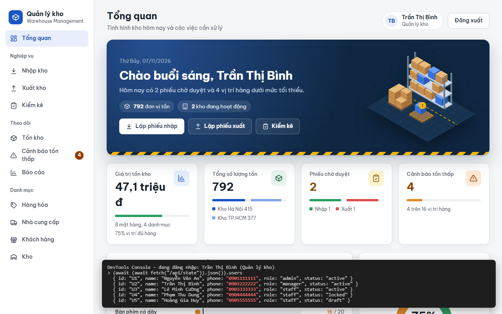
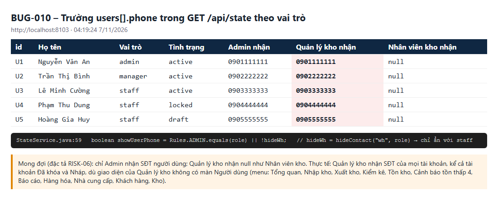

# BUG-010: Quản lý kho nhận được số điện thoại của mọi tài khoản qua /api/state

| | |
| --- | --- |
| **Mức độ** | Major (lộ thông tin cá nhân sai phân quyền; số điện thoại cũng là tên đăng nhập) |
| **Trạng thái** | Closed |
| **Liên quan** | RISK-06 · Bảng phân quyền 4.2 (ẩn liên hệ theo vai trò) · FR-01, FR-02 · TC-USR-06-01 |
| **Môi trường** | local-H2, agent1 http://localhost:8101 (BDD) và agent3 http://localhost:8103 (tái hiện), 07/11/2026 04:19 |
| **Phiên bản** | commit `aaaf02b` |
| **Vai trò** | manager |
| **Người ghi** | QA_QC (tự động: playwright-bdd) |
| **Ngày** | 2026-11-07 |

## Tóm tắt

Theo đặc tả, chỉ **Admin** được xem số điện thoại người dùng. Nhưng `GET /api/state` trả **đầy đủ số điện thoại của mọi tài khoản** cho Quản lý kho, gồm cả Admin, tài khoản Đã khóa và tài khoản Nháp. Nhân viên kho thì đã bị ẩn đúng (`null`).

Giao diện của Quản lý kho không có màn **Người dùng**, nên lỗi không lộ ra trên màn hình. Tuy vậy, dữ liệu đã nằm sẵn trong trình duyệt: mở DevTools hoặc gọi API là thấy. Số điện thoại cũng chính là tên đăng nhập, nên lỗi này giúp đoán tài khoản để thử mật khẩu, nhất là khi chưa có khóa tạm (BUG-001).

## Bước tái hiện

1. Đăng nhập Quản lý kho (`0902 222 222` / `123456`).
2. Mở DevTools, vào Console, chạy `(await (await fetch('/api/state')).json()).users`. Hoặc gọi `GET /api/state` bằng cookie phiên.
3. Xem trường `phone` của từng phần tử.
4. Lặp lại với Nhân viên kho (`0903 333 333`) và Admin để so sánh.

## Kết quả thực tế

| id | Họ tên | Vai trò | Tình trạng | Admin nhận | **Quản lý kho nhận** | Nhân viên kho nhận |
| --- | --- | --- | --- | --- | --- | --- |
| U1 | Nguyễn Văn An | admin | active | 0901111111 | **0901111111** | null |
| U2 | Trần Thị Bình | manager | active | 0902222222 | **0902222222** | null |
| U3 | Lê Minh Cường | staff | active | 0903333333 | **0903333333** | null |
| U4 | Phạm Thu Dung | staff | locked | 0904444444 | **0904444444** | null |
| U5 | Hoàng Gia Huy | staff | draft | 0905555555 | **0905555555** | null |

Menu của Quản lý kho: Tổng quan, Nhập kho, Xuất kho, Kiểm kê, Tồn kho, Cảnh báo tồn thấp, Báo cáo, Hàng hóa, Nhà cung cấp, Khách hàng, Kho. Không có **Người dùng**, nên vai trò này không có nhu cầu xem danh bạ tài khoản.

**Ảnh chụp**

| | |
| --- | --- |
| Trình duyệt của Quản lý kho: `fetch('/api/state')` trả SĐT của cả 5 tài khoản |  |
| So sánh `users[].phone` theo 3 vai trò và dòng code gây lỗi |  |

## Kết quả mong đợi

- Chỉ Admin nhận `users[].phone`. Quản lý kho và Nhân viên kho nhận `null`, như cách đang làm với Nhân viên kho.
- Nếu giao diện của Quản lý kho cần tên thủ kho (màn Kho), chỉ trả `id` và `name`, không trả SĐT.
- Cân nhắc: Quản lý kho có cần biết tài khoản nào Đã khóa hay Nháp không? Nếu không, ẩn luôn `status` và `opened`.

## Test phát hiện

`e2e/features/13-nguoi-dung.feature` :: **USR-06 › Manager nhận SĐT mọi người dùng** (`@TC-USR-06-01 @smoke @risk`)

- Lỗi test: `vai trò manager vẫn nhận SĐT người dùng (RISK-06)`, mảng nhận được gồm `U1…U5` đều có SĐT.
- Lỗi xảy ra cả khi chạy 4 worker lẫn 1 worker, trên CSDL mẫu.

## Phân tích nguyên nhân

File / hàm: `src/main/java/com/qlkho/service/StateService.java`, `build()` dòng 57–64:

```java
boolean hideWh = Rules.hideContact("wh", role);              // "wh" chỉ ẩn với STAFF
boolean showUserPhone = Rules.ADMIN.equals(role) || !hideWh; // → manager: !false = true
...
.map(u -> m("id", u.id, "name", u.name, "phone", showUserPhone ? u.phone : null, …))
```

Quyền xem SĐT **người dùng** bị gắn nhầm vào quy tắc ẩn liên hệ **kho** (`HIDE_CONTACT["wh"] = {STAFF}` trong `Rules.java:27-30`). Quản lý kho được xem SĐT kho, nên cũng được xem SĐT mọi tài khoản.

Hướng sửa gợi ý:

```java
boolean showUserPhone = Rules.ADMIN.equals(role);
```

Hoặc thêm khóa riêng `"user"` vào `HIDE_CONTACT` (`Set.of(MANAGER, STAFF)`) và dùng `!Rules.hideContact("user", role)`. Sau đó kiểm tra lại màn Kho của Quản lý kho: nếu đang hiện SĐT thủ kho lấy từ `users[].phone` thì đổi sang dùng SĐT của kho (`w.phone`).

## Đóng

- Commit sửa: `00fdf23` Fix BUG-001..011 (nhánh main, github.com/khanhle1511/Quan_Li_Kho_Hang)
- Ngày đóng: 2026-11-07
- Kiểm tra lại bằng: `TC-USR-06-01`, và bảng phân quyền SEC/USR-xx cho Admin (vẫn thấy SĐT)
- Cách sửa: `StateService.build()` đặt `showUserPhone = Rules.ADMIN.equals(role)`, tách khỏi quy tắc ẩn SĐT kho. Màn Kho (`index.html`, ô thủ kho) chỉ hiện SĐT thủ kho khi có giá trị, nên Quản lý kho thấy tên thủ kho và SĐT của kho (`warehouses[].phone`), không thấy SĐT tài khoản. Giữ nguyên `status`/`opened` vì giao diện Kho dùng để lọc ứng viên thủ kho.
- Kết quả kiểm tra lại (07/11/2026, local-H2 cổng 8097): `GET /api/state` → Admin thấy đủ 5 SĐT, Quản lý kho và Nhân viên kho nhận `null` cho cả 5 tài khoản. `TC-USR-06-01` đạt; feature 12-kho + 13-nguoi-dung (49 test, 1 worker): 43 đạt, 5 bỏ qua, 1 thất bại là TC-WH-03-01 @seed-data (tồn 416 ≠ 415 vì phiếu thử bằng curl đã duyệt trước đó, không liên quan).
