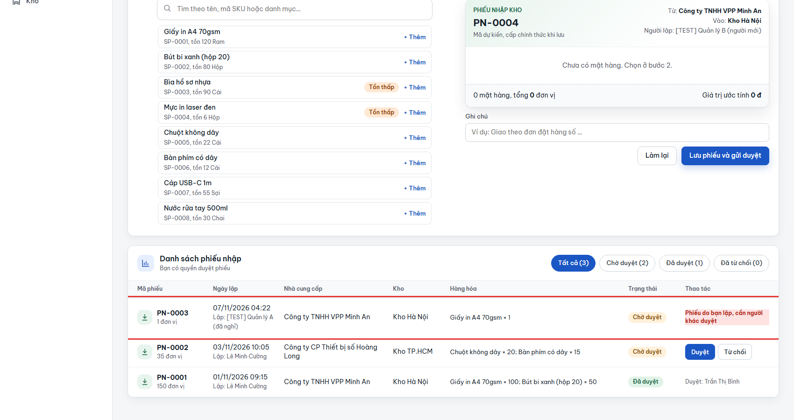
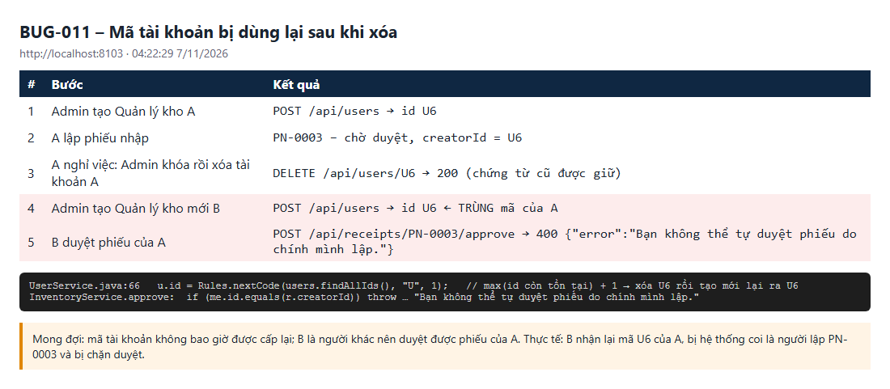

# BUG-011: Mã tài khoản bị cấp lại sau khi xóa, nên người mới bị coi là người lập phiếu của người cũ

| | |
| --- | --- |
| **Mức độ** | Major (sai danh tính trên chứng từ; người duyệt hợp lệ bị chặn; tham chiếu cũ trỏ sang người mới) |
| **Trạng thái** | Closed |
| **Liên quan** | BR-19 (xóa tài khoản đã khóa, chứng từ cũ được giữ) · BR-10 (không tự duyệt phiếu của mình) · UC04 · TC-USR-05-04, TC-USR-05-05 (phát hiện gián tiếp) · liên quan bản sửa BUG-007 |
| **Môi trường** | local-H2, agent1 http://localhost:8101 (BDD, bản build có sửa BUG-001…009) và agent3 http://localhost:8103 (tái hiện), 07/11/2026 04:22 |
| **Phiên bản** | commit `aaaf02b` + thay đổi chưa commit (sửa BUG-001…009, có `CreateTx`) |
| **Vai trò** | admin (xóa, tạo tài khoản), manager (duyệt phiếu) |
| **Người ghi** | QA_QC (tự động: playwright-bdd) |
| **Ngày** | 2026-11-07 |

## Tóm tắt

Mã tài khoản mới được tính bằng **mã lớn nhất đang tồn tại + 1**. Khi tài khoản có mã lớn nhất bị xóa, tài khoản tạo sau đó sẽ **nhận lại đúng mã đó**. Mọi dữ liệu còn trỏ tới mã cũ lúc này trỏ sang người mới:

- Phiếu do người cũ lập (`creatorId`): người mới bị coi là **người lập**, nên **không được duyệt** ("Bạn không thể tự duyệt phiếu do chính mình lập").
- Tham chiếu thủ kho của kho (`keeperId`), nếu còn, cũng trỏ sang người mới.
- Một Admin đang mở màn hình với dữ liệu cũ có thể khóa hoặc xóa nhầm người mới, vì cùng mã.

Ví dụ: Quản lý kho A (`U6`) lập PN-0003 rồi nghỉ việc, Admin khóa và xóa A. Admin tạo Quản lý kho B thì B nhận **`U6`**. B mở **Nhập kho** và thấy PN-0003 (người lập: A) với dòng `Phiếu do bạn lập, cần người khác duyệt`, không có nút Duyệt.

## Bước tái hiện

1. Admin tạo Quản lý kho A (`role: manager`, `active`). A nhận mã lớn nhất hiện có + 1, ví dụ `U6`.
2. A đăng nhập, lập phiếu nhập `P01 × 1` vào Kho Hà Nội. Phiếu `PN-0003` ở trạng thái chờ duyệt.
3. Admin **khóa** rồi **xóa** A (được phép theo BR-19; chứng từ cũ vẫn giữ).
4. Admin tạo Quản lý kho mới B.
5. B đăng nhập, vào **Nhập kho**, tìm PN-0003, hoặc gọi `POST /api/receipts/PN-0003/approve`.

## Kết quả thực tế

| # | Bước | Kết quả |
| --- | --- | --- |
| 1 | Admin tạo Quản lý kho A | `POST /api/users` → id **U6** |
| 2 | A lập phiếu nhập | PN-0003 – chờ duyệt, `creatorId = U6` |
| 3 | Admin khóa rồi xóa A | `DELETE /api/users/U6` → 200 |
| 4 | Admin tạo Quản lý kho mới B | `POST /api/users` → id **U6** (trùng mã của A) |
| 5 | B duyệt phiếu của A | **400** `{"error":"Bạn không thể tự duyệt phiếu do chính mình lập."}` |

Trên giao diện của B, dòng PN-0003 ghi "Lập: [TEST] Quản lý A (đã nghỉ)" nhưng cột Thao tác lại là "Phiếu do bạn lập, cần người khác duyệt".

**Ảnh chụp**

| | |
| --- | --- |
| Giao diện của B: phiếu của A bị coi là "do bạn lập", không có nút Duyệt (so với PN-0002 bên dưới) |  |
| Diễn biến từng bước và dòng code sinh mã |  |

## Kết quả mong đợi

- Mã tài khoản **không bao giờ được cấp lại**, kể cả khi tài khoản cũ đã bị xóa.
- B là người khác A nên duyệt được PN-0003.
- Chứng từ cũ vẫn trỏ đúng về A (đã xóa), không trỏ về ai khác.

## Test phát hiện

`e2e/features/13-nguoi-dung.feature`, chạy 4 worker trên agent1 (bản build đã có `CreateTx`):

- `TC-USR-05-04` › bước "T_USER đã lập 1 phiếu nhập và đã bị khóa": `lập phiếu in: {"error":"Phiên đăng nhập không còn hiệu lực…"}` (401).
- `TC-USR-05-05` › bước "T_USER là thủ kho của T_WH và đã bị khóa": `gán thủ kho: {"error":"Thủ kho đã chọn không còn tồn tại."}`.

Cơ chế lỗi trong test:

1. Kịch bản X xóa T_USER của nó, đang giữ mã lớn nhất, ví dụ `U8`.
2. Kịch bản Y tạo fixture và nhận lại `U8`.
3. Bước dọn dẹp của X khóa rồi xóa "U8", tức là xóa nhầm tài khoản của Y.

Máy chủ không ghi lỗi nào trong lượt chạy, vì `CreateTx` đã chặn trùng mã khi tạo đồng thời (BUG-007). Chạy 1 worker thì cả hai test đạt, vì không có kịch bản nào chen vào giữa.

Đề xuất bổ sung test riêng: tạo, khóa, xóa tài khoản có mã lớn nhất, tạo tài khoản mới, rồi kiểm tra mã khác mã cũ và người mới duyệt được phiếu của người cũ.

## Phân tích nguyên nhân

File: `src/main/java/com/qlkho/service/UserService.java:66`

```java
u.id = Rules.nextCode(users.findAllIds(), "U", 1);   // max(mã còn tồn tại) + 1
```

`findAllIds()` chỉ trả mã của tài khoản **còn tồn tại**. Xóa tài khoản có mã lớn nhất làm "mã lớn nhất" giảm xuống, nên mã đó được cấp lại. Các bảng khác vẫn giữ mã cũ dưới dạng chuỗi, không có khóa ngoại: `phieu.creator_id`, `kho.keeper_id`… `InventoryService.approve()` so `me.id.equals(r.creatorId)` nên nhận nhầm người.

Hướng sửa gợi ý (chọn một):

- Sinh mã từ **sequence / bảng đếm chỉ tăng**, không suy ra từ dữ liệu hiện có. `CreateTx` đã khóa tuần tự, nên chỉ cần thêm bảng `ma_tiep_theo(loai, so)` và tăng ở đó.
- Hoặc **xóa mềm**: giữ dòng tài khoản với trạng thái `deleted` thay vì xóa thật, để mã không bao giờ trống.
- Hoặc dùng mã không tuần tự (UUID) làm khóa, còn "U6" chỉ là mã hiển thị.

Cũng nên rà các loại mã khác có thể bị xóa rồi cấp lại. Hiện chỉ tài khoản và kho xóa được; mã kho do người dùng nhập nên không bị ảnh hưởng.

## Đóng

- Commit sửa: `00fdf23` Fix BUG-001..011 (nhánh main, github.com/khanhle1511/Quan_Li_Kho_Hang)
- Ngày đóng: 2026-11-07
- Kiểm tra lại bằng: test mới "mã tài khoản không cấp lại sau khi xóa" và chạy `13-nguoi-dung.feature` với 4 worker (`TC-USR-05-04`, `TC-USR-05-05` đạt)
- Cách sửa: thêm bảng đếm chỉ tăng `ma_tiep_theo` (entity `CodeSeq`, repo `CodeSeqRepo` đọc kèm `FOR UPDATE`). `CreateTx.nextNumber(kind, existingIds, prefix)` lấy số từ bảng này (lần đầu khởi tạo từ mã lớn nhất đang có, về sau lấy max của bộ đếm và mã đang tồn tại), chạy trong khóa của `CreateTx`. `UserService.create()` dùng `"U" + create.nextNumber("U", …)` thay cho `Rules.nextCode`. Bảng được Hibernate tự tạo (`ddl-auto=update`), CSDL cũ không cần migrate. Các mã khác (phiếu, đối tác, hàng hóa, kiểm kê) không xóa được nên giữ cách cũ.
- Test mới: `TC-USR-05-06` "Mã tài khoản không cấp lại sau khi xóa" trong `13-nguoi-dung.feature` (T_USER lập phiếu → khóa → xóa → tạo Quản lý kho mới → mã khác và duyệt được phiếu của T_USER).
- Kết quả kiểm tra lại (07/11/2026, local-H2 cổng 8097): curl: A = U6 lập PN-0003, khóa + xóa A, tạo B → **U7**; B duyệt PN-0003 → 200; phiếu vẫn ghi creatorId U6 "QLK A". `13-nguoi-dung.feature` chạy 4 worker: 24 đạt, 1 bỏ qua (TC-USR-05-04, 05-05, 05-06 đều đạt, không còn xóa nhầm tài khoản của kịch bản khác).
